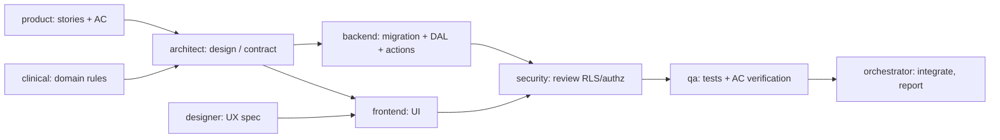

# Agent Workflow

How the specialized Claude Code subagents are organized, invoked and coordinated.

## 1. The team

All agents are native Claude Code subagents defined in `.claude/agents/<name>.md` (YAML frontmatter:
`name`, `description`, `tools`, `model`, followed by the system prompt).

| Agent | Model (frontmatter) | Owns | Tools |
|---|---|---|---|
| `architect` | `opus` | Architecture, DB design, API contracts, ADRs, conventions | Read, Write, Edit, Glob, Grep, Bash, WebFetch, WebSearch |
| `frontend` | `sonnet` | Next.js UI, components, portal and dashboard, a11y, i18n strings | Read, Write, Edit, Glob, Grep, Bash |
| `backend` | `sonnet` | Migrations, server actions, DAL, validation, storage, seeds | Read, Write, Edit, Glob, Grep, Bash |
| `security` | `opus` | Auth, MFA, RBAC, RLS, tenancy, guardian/minor privacy, audit, reviews | Read, Write, Edit, Glob, Grep, Bash, WebFetch, WebSearch |
| `clinical` | `sonnet` | Clinical domain requirements and workflows (no invented protocols) | Read, Write, Edit, Glob, Grep, WebFetch, WebSearch |
| `activities` | `sonnet` | Resource library, block builder, versioning, assignments, responses, renderers | Read, Write, Edit, Glob, Grep, Bash |
| `qa` | `haiku` (escalate → `sonnet`) | Unit/integration/E2E/permission tests, acceptance verification | Read, Write, Edit, Glob, Grep, Bash |
| `designer` | `opus` (routine specs → `sonnet`) | Brand research, visual identity, design system, UX specs | Read, Write, Edit, Glob, Grep, WebFetch, WebSearch |
| `product` | `sonnet` | Requirements, stories, journeys, MVP, roadmap, SaaS strategy | Read, Write, Edit, Glob, Grep, WebFetch, WebSearch |

`clinical`, `designer` and `product` have no `Bash`. They write documents and specs, not code. `designer`
and `product` still need write access to their own docs.

## 2. Model routing

- The frontmatter `model` is the default for each agent. Valid values are `opus`, `sonnet`, `haiku` and `inherit`.
- The orchestrator can override the model for one invocation (the Agent tool's `model` parameter):
  - **Escalate** `qa` to `sonnet` for flaky integration tests, auth/RLS debugging, or multi-module failures.
  - **De-escalate** `designer` to `sonnet` for routine component specs that follow an approved system.
  - **Escalate** `backend` to `opus` for complex migrations that touch clinical immutability triggers or RLS helper functions. Security still reviews them.
- Use cheaper models for repetitive work (string extraction, simple test scaffolds, doc formatting).
- Report the model actually used. If a model is unavailable, pick the closest available one and record the substitution.

## 3. Invoking agents

**Discovery:** Claude Code loads `.claude/agents/` when a session starts. Agents added during a session are
available from the **next session**. Run `/agents` to list and edit them.

**Individually** (natural language, from the main session):

```text
Use the security agent to review supabase/migrations/20260115_patients.sql and the patients DAL.
```

```text
Ask the designer agent to specify the empty, loading and error states for the patient list.
```

You can also name the agent explicitly: `@agent-architect propose the folder structure for the activities module`.

**In parallel** (independent tasks with disjoint files):

```text
In parallel:
- backend: implement the migration for patients and guardians (supabase/migrations/…)
- frontend: build the patient list UI from DESIGN_SYSTEM.md using mocked data (src/modules/patients/components/…)
- product: write acceptance criteria for guardian invitation (docs/PRODUCT_REQUIREMENTS.md)
Then have security review the migration and QA write permission tests.
```

The orchestrator sends all independent Agent calls in a single message, waits for every result, and then
runs the dependent steps.

## 4. Standard delivery pipeline (per feature)



Stages with no edge between them (product ↔ clinical ↔ designer; backend ↔ frontend once the contract is
fixed) run in parallel.

## 5. Ownership and conflict rules

1. Each file has one owner at a time. The orchestrator assigns files in the delegation prompt.
2. Shared files (`messages/*.json`, `src/server/authz/*`, `tailwind.config`, root configs) go through their owner: i18n catalogs → frontend, authz → security/backend, tokens → designer spec + frontend implementation, configs → architect.
3. Architectural disagreements go to the architect. Security findings marked **Critical/High** block merge.
4. Design deviations go back to the designer. Frontend does not improvise identity.
5. No agent writes production clinical-protocol logic without `clinical` sign-off and psychologist input.

## 6. Reporting contract (every agent, every task)

```text
FILES MODIFIED: …
DECISIONS: … (ADR refs)
TESTS: commands run + real results | "none (docs only)"
SECURITY REVIEW NEEDED: yes/no — why
PENDING / QUESTIONS: …
```

Agents must not fabricate completed work, test runs, brand findings or legal conclusions.

## 7. Phase 0 execution log

Phase 0 deliverables were produced by subagents running each agent's role definition. The new project
agents were created during this same session, so Claude Code had not discovered them as named agent
types yet. Each workstream ran as a `general-purpose` subagent that first loaded its
`.claude/agents/<name>.md` role file, with the model override set to the agent's assigned model. From
Phase 1 on, invoke the named agents directly.
