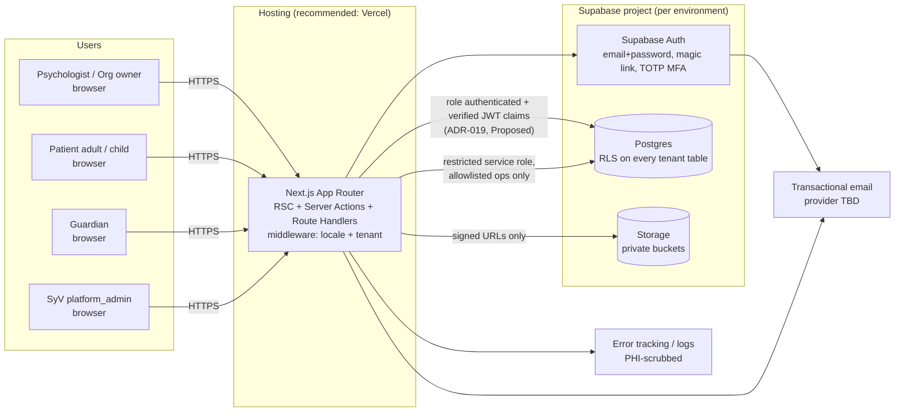
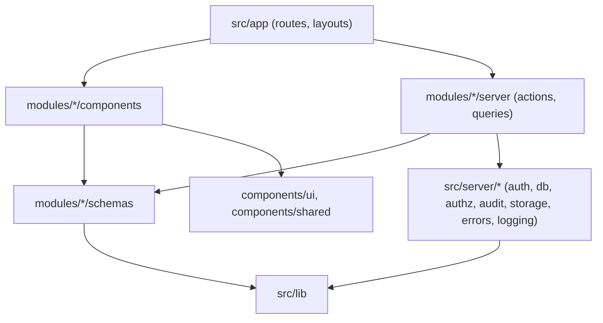

# Architecture — Psi (SyV Solutions)

> Status: **Phase 0 — Proposed** (documentation only; nothing here is implemented).
> Owner: architect agent. Access-control content must be reviewed by the security agent.
> Related: [DATABASE.md](./DATABASE.md) · [API_CONTRACTS.md](./API_CONTRACTS.md) · [DECISIONS.md](./DECISIONS.md)

Psi is a multi-tenant, bilingual (es/en) psychological practice management SaaS built by
SyV Solutions. The first tenant is the clinical brand "Daniela Ortega — Psicóloga"
(Colombia). The product has two surfaces:

- **Professional dashboard** — organization owners and psychologists manage patients,
  clinical records, sessions, notes, consents, resources and therapeutic activities.
- **Patient portal** — patients (adult or child/adolescent mode) and guardians complete
  assigned activities, view shared resources, sign consents and manage preferences.

Out of MVP scope: video calls, payments, billing, native apps, AI diagnosis, automated
recommendations, advanced scheduling. Nothing in this architecture may preclude adding
them later, but nothing is built for them now.

Legal note: nothing in this document asserts regulatory compliance (Ley 1581/2012,
Resolución 1995/1999, Ley 1090/2006, Ley 1098/2006, etc.). Items that depend on law are
marked `[NEEDS LEGAL VERIFICATION]`.

---

## 1. System context



Key properties:

1. **The browser never talks to Postgres directly for domain data** — and this must be
   *enforced*, not just a convention. Any user's JWT plus the public key can otherwise call
   the Supabase Data API (PostgREST) and Storage API directly (SECURITY.md A4, F-01). How we
   close that surface is **ADR-019 (Proposed — awaiting client approval)**: Option A
   (recommended) disables the Data API for domain schemas; Option B keeps it and splits
   sensitive columns. Until ADR-019 is accepted, **RLS and grants must be sufficient on their
   own** for confidentiality (§6.2).
2. **RLS is the second line of defense**, not the only one. Every server query runs as the
   user (role `authenticated` + the user's verified claims) so RLS still applies even if an
   app-layer check is missing.
3. **The service-role key is restricted** to a small, allowlisted set of server operations
   (see §6.4) and never reaches client bundles.
4. **Auth flows run server-side where possible** (sign-in, MFA challenge/verify via server
   actions) so session cookies can be `HttpOnly`; no browser Supabase client for domain data.

---

## 2. Deployment topology (recommendation)

| Component | Recommendation | Notes |
|---|---|---|
| Web app | Vercel (Next.js native), one project, environments: Preview / Staging / Production | Alternative: any Node host with Next.js standalone output. |
| Database/Auth/Storage | Supabase hosted, **one project per environment** (local, staging, production) | Never share a project between staging and production. |
| Region | Choose Supabase region and Vercel function region **co-located** | Data residency / international transfer `[NEEDS LEGAL VERIFICATION]` (Ley 1581 transfer rules). Candidate: `sa-east-1` (São Paulo) or `us-east-1`. Client decision. |
| Email | Transactional provider (e.g. Resend / Postmark / SES) configured as Supabase Auth SMTP and for app notifications | Emails must contain **no clinical content**, only links. |
| DNS | App domain owned by SyV (e.g. `app.<syv-domain>`), optional per-org custom domains for portal white-label | Custom domains: open decision (ADR-017). |
| Secrets | Vercel encrypted env vars; Supabase keys per env | Service-role key only in server env, never `NEXT_PUBLIC_*`. |
| Backups | Supabase daily backups + PITR on production (paid add-on) | See §17. |

Functions run in the **Node.js runtime** (not Edge) for anything touching the database,
so we can use a Postgres connection (ADR-019), crypto and structured logging. Middleware
(locale + tenant resolution) runs at the edge but performs **no data access beyond a
cached host→organization lookup** (see §8) and is **never an authorization boundary**.

---

## 3. Folder structure

```
/
├─ docs/                         # ARCHITECTURE, DATABASE, API_CONTRACTS, DECISIONS, SECURITY…
├─ messages/
│  ├─ es.json                    # UI strings (Spanish, default)
│  └─ en.json                    # UI strings (English)
├─ public/                       # static, non-tenant assets only
├─ supabase/
│  ├─ config.toml
│  ├─ migrations/                # timestamped SQL, the ONLY way schema changes
│  ├─ seed.sql                   # synthetic data only — never real patient data
│  └─ tests/                     # pgTAP RLS/trigger tests
├─ src/
│  ├─ app/
│  │  └─ [locale]/
│  │     ├─ (auth)/              # sign-in, MFA, recovery, invitation acceptance
│  │     ├─ (professional)/      # dashboard: patients, records, activities, settings
│  │     ├─ (portal)/            # patient/guardian portal (adult + child modes)
│  │     └─ layout.tsx           # NextIntlClientProvider, theme variables
│  │  └─ api/                    # route handlers: signed URLs, exports, webhooks
│  ├─ i18n/                      # next-intl routing, request config, formatters
│  ├─ modules/
│  │  └─ <domain>/               # see §4 for the domain list
│  │     ├─ schemas/             # Zod schemas + inferred types (isomorphic, no I/O)
│  │     ├─ server/              # 'server-only': DAL queries, actions, policies
│  │     │  ├─ queries.ts
│  │     │  ├─ actions.ts        # 'use server' entry points
│  │     │  └─ policy.ts         # permission checks for this domain
│  │     ├─ components/          # domain UI (server + client components)
│  │     └─ index.ts             # public surface of the module (types + components)
│  ├─ components/
│  │  ├─ ui/                     # shadcn/ui generated primitives (owned by designer/frontend)
│  │  └─ shared/                 # cross-domain presentational components
│  ├─ server/
│  │  ├─ auth/                   # session retrieval, AAL/MFA checks, current profile
│  │  ├─ db/                     # request-bound DB handle (ADR-019), admin client (restricted)
│  │  ├─ authz/                  # AuthzContext, permission registry, requirePermission()
│  │  ├─ audit/                  # audit event writer + event catalog
│  │  ├─ tenancy/                # organization resolution
│  │  ├─ storage/                # bucket/path helpers, signed URL issuance
│  │  ├─ errors/                 # AppError, error codes, Result helpers
│  │  └─ logging/                # structured logger with PHI scrubbing
│  ├─ lib/                       # pure utilities (dates, ids, hashing) — no I/O
│  ├─ styles/                    # Tailwind entry, CSS variable tokens
│  └─ middleware.ts              # next-intl + tenant host resolution
├─ tests/
│  ├─ unit/                      # Vitest: schemas, policies, pure logic
│  ├─ integration/               # Vitest against local Supabase: DAL + RLS + triggers
│  ├─ e2e/                       # Playwright: critical flows per role
│  ├─ authz/                     # permission matrix tests (generated from registry)
│  └─ fixtures/                  # synthetic personas & seed builders
└─ (root configs: tsconfig, eslint, prettier, next.config, tailwind, vitest, playwright)
```

### 3.1 Domain modules

| Module | Responsibility |
|---|---|
| `organizations` | Org lifecycle, settings, domains, branding |
| `members` | Memberships, membership roles, invitations (staff) |
| `profiles` | User profile, locale preference, professional profile |
| `patients` | Patient demographics, portal access, preferences, care team |
| `guardians` | Guardian records, patient↔guardian relationships, guardian permissions |
| `clinical-records` | Record, structured sections and revisions, assessments, diagnoses |
| `treatment` | Treatment plans and goals |
| `sessions` | Therapy sessions (light scheduling: date/time, status, modality) |
| `notes` | Clinical notes, finalization, addenda |
| `documents` | Clinical documents and file objects |
| `consents` | Consent templates, versions, consent records, revocations |
| `resources` | Resource library and resource shares |
| `activities` | Categories, activities, versions, blocks, block registry |
| `assignments` | Activity assignments and responses (portal side + professional review) |
| `content-i18n` | Therapeutic content translations with review status |
| `privacy` | Data subject requests, exports, retention policy configuration |
| `audit` | Audit log query UI (write path lives in `src/server/audit`) |
| `platform` | Platform admin: org provisioning, break-glass grants (no clinical UI) |

---

## 4. Module boundaries & dependency rules



Rules (enforced with `eslint-plugin-boundaries` or `no-restricted-imports` — dependency to
be justified in Phase 1):

1. `src/app` may import a module only through its `index.ts` or its `server/actions.ts`.
2. `modules/*/server/**` and `src/server/**` start with `import 'server-only'`. Client
   components can never import them.
3. A module may import **another module's schemas and public types**; it may **not** import
   another module's `server/queries.ts`. Cross-domain reads go through the other module's
   exported server functions (e.g. `notes` asks `patients` "is this patient in the org and
   in my care team" via `patients/server/policy.ts`).
4. `src/server/db/admin.ts` (service role) may be imported only from an explicit allowlist
   of files (lint rule). See §6.4.
5. `schemas/` are pure (Zod + types). No I/O, no environment access — safe in client and
   server.
6. No module reaches into `supabase/` SQL directly; types are generated
   (`supabase gen types`) into `src/server/db/types.gen.ts`.
7. Circular dependencies between modules are forbidden (`import/no-cycle`).

---

## 5. Roles & actors (summary)

| Actor | How represented | Clinical access |
|---|---|---|
| `platform_admin` | Row in `platform_admins` (not a membership) | **None implicit.** Break-glass only: read-only, approved by the org owner (+ treating psychologist) and a second SyV admin, ≤ 4 h, audited (ADR-014). |
| `organization_owner` | `membership_roles.role = organization_owner` | Administrative only. Clinical access only if also `psychologist` **and** on the patient's care team (open decision Q-03). |
| `psychologist` | `membership_roles.role = psychologist` | Patients where the membership is an active `care_team_members` row. |
| `patient` | `patients.profile_id` linked to an auth user | Own assignments, own responses, shared resources, own consents. **Never** clinical notes, record sections, diagnoses. |
| `guardian` | `guardians` row (optionally linked to a profile) + `patient_guardians` relationship + `patient_guardian_permissions` | Only what each granted permission allows, for that specific patient, while the relationship is active. |

Detailed permission matrix: SECURITY.md §4.1. The permission registry in
`src/server/authz/permissions.ts` is the single source of truth in code; tests are generated
from it (§14) and assert that the TS policy and the real-JWT database result agree.

**One profile, several capacities.** A profile can be guardian and patient in the same org (an
adult patient whose child is also treated), or staff in one org and patient/guardian in another.
Each request runs in exactly one explicit **acting-as** capacity chosen per session
(API_CONTRACTS §4). Staff ↔ patient and staff ↔ guardian in the **same** org are forbidden by
DB triggers in MVP (F-21) `[NEEDS PSYCHOLOGIST INPUT]`.

---

## 6. Data access

### 6.0 Access path — ADR-019 (Proposed, awaiting client approval)

| | Option A (recommended) | Option B |
|---|---|---|
| Browser query surface | None: Data API (PostgREST) and GraphQL disabled for domain schemas | PostgREST reachable with any user JWT |
| Server → Postgres | Pooled Postgres connection as a non-privileged login role; per transaction `set local role authenticated` + `set_config('request.jwt.claims', <verified claims>, true)` → `auth.uid()`/`auth.jwt()` and RLS behave exactly as for PostgREST | supabase-js with the user's JWT |
| Column confidentiality | DAL chooses columns (DTOs); RLS controls rows | Sensitive columns moved to care-team-only tables; portal reads via audited `SECURITY DEFINER` functions |
| Read auditing | Complete (all reads go through the DAL) | Direct reads unaudited unless Postgres-side logging |

Details, trade-offs and Supabase implications (Realtime, Storage, tooling) are in ADR-019. The
rest of this section is written so that it holds under either option; the DB model marks the
Option-B-only splits with **[B]** (DATABASE.md §1 rule 10).

### 6.1 Server-only Data Access Layer (DAL)

- Every query lives in `modules/<domain>/server/queries.ts` and receives an
  `AuthzContext` as its first argument. No query function exists without one.
- The DAL obtains its database handle from `src/server/db/server.ts`, which binds the
  **verified** identity of the request (Option A: a transaction with role + claims taken only
  from a token verified server-side; Option B: the cookie-bound Supabase server client).
- DAL functions **always filter by `organization_id` explicitly**, even though RLS would
  also enforce it. This makes intent obvious and keeps query plans index-friendly.
- DAL returns DTOs (mapped, typed) — never raw rows with columns the caller should not
  see. DTOs are a least-data measure, **not** a confidentiality control under Option B.

### 6.2 RLS as second line (and the only line for direct access)

- RLS enabled + `FORCE ROW LEVEL SECURITY` on every table in `public`; `anon` has no grants
  on domain tables; DELETE revoked on clinical/consent/audit/published tables.
- Policies call helper functions in a dedicated, **non-exposed** `app` schema with
  `set search_path = ''`: `app.is_org_member(org)`, `app.can_read_clinical(org, patient)`,
  `app.can_write_clinical(org, patient)`, `app.guardian_can(org, patient, permission)`,
  `app.is_patient_self(org, patient, need)`. Helpers are `STABLE`, use indexed paths, and
  **require `aal2`** for every staff, clinical and platform check (F-03), so an aal1 session
  cannot read clinical rows even if it reaches Postgres.
- Helpers deny when the organization status does not allow the operation (DATABASE.md §5.1).
- Views are `security_invoker = true`; column-restricted projections are `SECURITY DEFINER`
  functions with explicit checks, never views (F-05).
- Integrity rules that protect clinical or consent meaning (response submission, consent
  signing, status transitions) are enforced in the database (F-10), not only in Zod.
- Default deny: no policy → no access.

### 6.3 Atomic multi-step writes

Mutations that must be atomic (finalize note + audit, create activity version + blocks,
publish version, sign consent + evidence, submit response) are **Postgres functions**
(`SECURITY INVOKER` by default so RLS applies; `SECURITY DEFINER` only where an invariant needs
rows the caller cannot read). Under Option A they are called inside the request transaction;
under Option B via `rpc()`. Each writes its domain rows and its audit row in one transaction.

### 6.4 Restricted service role

`src/server/db/admin.ts` exposes narrow functions, not a raw client:

| Allowed use | Why it needs elevated rights |
|---|---|
| Invitation acceptance (link new auth user to membership / patient / guardian) | Caller has no membership yet |
| Auth admin operations (create user for invitation, revoke sessions, MFA factor reset after recovery-code use, ADR-021) | Supabase Auth admin API |
| Platform org provisioning | Creates first org + owner membership |
| Scheduled jobs (expire invitations/grants, majority transition, export cleanup, rate-limit purge) | No user context |
| Signed URL creation **after** `app.can_read_file()` returned true in the user's RLS-bound transaction | Storage RLS denies direct reads to `authenticated` (§12) |
| Writing audit rows for **failed/denied** access attempts (`app.write_system_audit`) | User may lack rights for that org |

Every service-role call logs an audit event with `actor_type = 'system'` or the
initiating user, and is covered by an integration test.

---

## 7. Request lifecycle with authorization

```mermaid
sequenceDiagram
  participant B as Browser
  participant MW as middleware.ts
  participant RSC as Server Action / RSC
  participant AZ as src/server/authz
  participant DAL as module DAL
  participant PG as Postgres (RLS)
  participant AU as audit

  B->>MW: request /es/patients/123
  MW->>MW: strip inbound x-org-* / x-request-id; next-intl locale; tenant hint (host→org)
  MW->>RSC: forward (headers: x-request-id, x-org-hint — untrusted hint)
  RSC->>AZ: getAuthzContext()
  AZ->>AZ: verify session (getUser, not getSession), AAL level
  AZ->>PG: load memberships/roles/patient+guardian links (cached per request)
  AZ-->>RSC: AuthzContext {profileId, orgId, actingAs, roles, aal}
  RSC->>RSC: Zod-parse input
  RSC->>AZ: requirePermission(ctx, 'clinical.note.read', {patientId})
  AZ-->>RSC: ok | AppError(FORBIDDEN/NOT_FOUND)
  RSC->>DAL: getNote(ctx, id)
  DAL->>PG: select ... where organization_id = ctx.orgId (RLS re-checks)
  PG-->>DAL: rows
  DAL->>AU: record('clinical_note.viewed') (for clinical reads)
  DAL-->>RSC: DTO
  RSC-->>B: rendered UI / Result<T>
```

Rules:

1. **Authenticate** with `supabase.auth.getUser()` (server-verified), never trust
   `getSession()` alone.
2. **MFA**: professional and platform routes require `aal2` (TOTP); the same check is
   repeated inside the RLS helpers (§6.2). High-risk actions (finalize, export, role change,
   grant approval) require an MFA verification within the last 15 min. Recovery: ADR-021.
   Portal MFA optional (Q-07).
3. **Validate** all input with Zod before any I/O; **rate-limit** per ADR-020.
4. **Authorize** via `requirePermission()` with the resource scope (org, patient,
   assignment). Unauthorized access to an existing resource in another tenant returns
   `NOT_FOUND` (no enumeration).
5. **Execute** through the DAL (RLS applies). Authorization in a layout is never sufficient
   (layouts do not wrap server actions); every page, action and route handler checks itself.
6. **Audit** clinical reads and all mutations (§13).
7. **Respond** with a `Result<T>` (see API_CONTRACTS.md); never throw raw DB errors to the
   client.

### Auth implementation notes (Phase 1.3)

- **No browser Supabase client.** Sign-in, MFA, recovery and invitation acceptance are server
  actions (`src/modules/auth/server/actions.ts` → `src/server/auth/*`); session cookies are
  `httpOnly`, `SameSite=Lax`, host-only, `Secure` in production (`src/lib/auth-cookies.ts`).
- **Proxy (`src/proxy.ts`, no DB):** strips inbound `x-org-*`/`x-request-id`/`x-next-intl-locale`,
  sets `x-request-id`; when an auth cookie exists, `getClaims()` (local JWKS check, refresh when
  expired) writes refreshed cookies onto the forwarded request and the response; enforces the
  session policy (absolute 12 h from `amr`, idle 15 min via an httpOnly activity cookie →
  `signOut` + redirect); then next-intl. Full verification (`getUser`) stays in
  `src/server/auth/claims.ts`.
- **Tenant host** is resolved on the server (`src/server/tenancy/request.ts`) from
  `x-forwarded-host` and `Host`, keeping the more restrictive scope; it only narrows the caller's
  capacities (tenant host → that org only, no platform capacity; unknown host → none). No org
  header is forwarded.
- **Guards:** `(professional)` layout + every page (`src/modules/auth/server/guards.ts`):
  no session → sign-in; aal1 with any staff/platform capacity → `/mfa` (or `/mfa/enroll`);
  not acting as staff (incl. `platform_admin`) → access-denied screen. `(portal)`: Phase 1 denies
  every session (no portal identities exist); signed-out users see only the dev static preview
  when `isPortalPreviewEnabled()`.
- **Recovery:** Supabase recovery email (token_hash) → `/api/auth/confirm/<locale>` (server
  `verifyOtp`) → `/reset-password`; MFA users must reach aal2 first (Supabase Auth enforces it).
- **App-sent email** (invitations, MFA-reset notice): `src/server/auth/mailer.ts`, local Mailpit
  only; production provider pending (fails closed).

---

## 8. Tenancy resolution

The organization is the tenant (ADR-002). Resolution order:

1. **Host mapping** — `organization_domains` maps a host (`<slug>.<app-domain>`; custom
   domains post-MVP, Q-02) to an organization. Used primarily by the portal for white-label.
   Middleware reads a short-lived cached map; it **first deletes any inbound `x-org-*`
   header** (F-16), then sets `x-org-hint`. The hint is untrusted input.
2. **Active organization cookie** — for professional users with several memberships, an
   `active_org` cookie selects the org. It is a *hint*.
3. **Server validation** — `getAuthzContext()` always verifies that the user actually
   belongs to the hinted org (membership, patient link or guardian link). A hint never
   grants access. If invalid → fall back to the user's only org or show an org picker.

The URL path deliberately **does not** contain the org id (`/[locale]/...` only): it keeps
links shareable across white-label hosts and prevents treating the URL as an authority.

Cross-host rules: cookies are **host-only** (no `Domain=` attribute spanning tenant
subdomains); Supabase Auth redirect URLs are listed per host; `next.config`
`experimental.serverActions.allowedOrigins` lists the app host and the tenant subdomain
pattern explicitly (no broader wildcard) so the Next.js Origin check protects server actions
against CSRF; side-effecting route handlers verify `Origin` and use POST.

**Organization status** (`active`, `read_only`, `suspended`, `closed`) is enforced in the DB
helpers (DATABASE.md §5.1); the app shows a neutral notice page for denied states.

Portal users (patient/guardian) usually belong to exactly one org; a guardian could be
linked to patients in two orgs, so the same validation applies.

---

## 9. Internationalization

- **Library**: `next-intl` with locale-prefixed routing: `/es/...`, `/en/...`
  (`localePrefix: 'always'`). Default locale `es`. ADR-009.
- **Locale selection order**: explicit URL → user preference (`profiles.locale`) →
  organization default (`organizations.default_locale`) → `Accept-Language` → `es`.
  After sign-in, the user is redirected to their preferred locale.
- **UI strings**: `messages/es.json`, `messages/en.json`, namespaced per module
  (`patients.list.title`). CI fails if keys diverge between the two files.
- **Dates, numbers, times**: `next-intl` formatters with the **organization time zone**
  (`organizations.time_zone`, default `America/Bogota`) unless the user overrides. All
  timestamps stored as `timestamptz` (UTC).
- **Clinical content is never auto-translated.** Notes, record sections, diagnoses text,
  patient responses are stored and displayed in the language they were written in, with a
  `content_locale` column where useful.
- **Therapeutic content translations** (activity versions, resources, consent templates)
  are explicit, human-authored and tracked in `content_translations` with a review status
  (`draft → in_review → approved`, or `rejected`). Only `approved` translations are shown
  to patients; otherwise the source language is shown. Machine translation, if ever added,
  would enter as `draft` and require human approval (not in MVP).
- **Consent texts**: each consent template version is authored per locale; the accepted
  text hash covers the exact locale shown (see DATABASE.md §Consents).
- **Enum labels** (statuses, roles) are translated in `messages/*`, never stored as text.

---

## 10. White-label theming pipeline

ADR-010. Per organization branding is data, not code.

1. `organization_branding` stores: display name, logo/favicon file references, a small set
   of **semantic color tokens** (primary, primary-foreground, accent, radius scale…),
   optional font choice from an allowlist, portal welcome copy per locale.
2. On request, the root layout loads branding for the resolved org (cached, tag-revalidated
   on change — branding is the **only** tenant data allowed in the Next.js data cache) and
   emits a nonce-bearing `<style>` block of CSS variables on `:root`
   (`--brand-primary: 222 47% 31%;` in shadcn HSL format). Tailwind config maps
   `colors.primary` etc. to these variables. shadcn components consume them unchanged.
3. Values are **validated server-side** (Zod: color formats, allowlisted fonts, max
   lengths) and **contrast-checked** (WCAG AA against foreground) before saving; invalid
   palettes are rejected rather than rendered. No arbitrary CSS input is accepted.
4. Child-mode portal uses an additional token set (larger radius, playful palette
   variants) derived from the brand tokens by the designer's rules — not free CSS.
5. Logos are served from the `branding` bucket (non-PHI), public-read for logos/favicons
   only (Q-09, approved by security with conditions): PNG/WebP/ICO only — **no SVG** (F-18) —
   re-encoded server-side, random object names, object listing disabled, writes only via an
   owner server action, no staff or patient photos.
6. Emails use the org display name and logo URL; no clinical content.

---

## 11. Activity block rendering

ADR-008. Activities are composed of **predefined safe blocks**; no arbitrary HTML/JS.

- **Block schema**: a Zod discriminated union on `type`:
  `text`, `image`, `multiple_choice`, `open_response`, `scale`, `emotion_selector`,
  `audio`, `video`, `game`. Each block config has a `schemaVersion` integer.
- **Rich text** inside `text`/instructions uses a restricted AST (paragraph, heading
  levels 2–3, bold, italic, bullet/numbered list, link with allowlisted protocols
  `https:`/`mailto:`). Stored as JSON AST, rendered by our React components. No
  `dangerouslySetInnerHTML` anywhere in the renderer tree (lint rule).
- **Media blocks** reference `file_objects` ids (private storage, signed URLs) or, for
  video, an allowlisted embed provider id + video id (security to approve list) — never a
  raw iframe URL.
- **Games** reference a `game_type` from a fixed catalog implemented in code (e.g.
  `memory_match`, `drag_sort`, `emotion_matching`) with a typed config per game type.
- **Versioned block schema**: when a block schema changes, `schemaVersion` is bumped and a
  pure upgrader function (`upgradeBlock(v1) → v2`) is registered. Stored published blocks
  are **never rewritten**; they are upgraded in memory at render time.
- **Renderer registry**:
  `blockRenderers: Record<BlockType, { adult: Component; child: Component; review: Component }>`.
  `review` is the professional view of a patient's response. Unknown type or failed
  parse → safe fallback ("content unavailable") + logged error, never a crash.
- **Responses**: each answerable block has a matching response Zod schema
  (`responseSchemaFor(block)`); the server validates every `activity_response_item`
  against the pinned version's block before saving.
- No scoring engine produces diagnoses or conclusions; scales show raw values to the
  psychologist.

---

## 12. Storage

ADR-011.

| Bucket | Content | Access |
|---|---|---|
| `clinical-documents` | Clinical documents, signed consent scans, exports | Private; care team only |
| `activity-media` | Images/audio/video used in activity blocks | Private; org members + assigned patients/guardians |
| `resources` | Resource library files | Private; org members + patients with a share |
| `branding` | Logos, favicons (PNG/WebP/ICO, no SVG) | Public-read, no listing (Q-09); write by org owner via server action |
| `exports` | Generated record exports / DSR packages | Private; requester only; auto-expire |

**Path convention** (enforced by storage RLS on `storage.objects` using path segments):

```
<bucket>/org/<organization_id>/<domain>/<entity_id>/<file_object_id>.<ext>
e.g. clinical-documents/org/9f…/patients/41…/c2….pdf
```

- File names never contain patient names or PHI.
- Every stored object has a `file_objects` row (mime, size, sha256, uploaded_by). Upload
  flow: server issues **signed upload URL** → client uploads → server action confirms,
  verifies size/mime/hash, then links the file to its domain entity.
- **Signed URL TTLs** (configurable constants, not hardcoded in callers):
  clinical documents and exports **60 s**; activity media and resources **10 min** (long
  enough for an audio/video session); signed upload URLs **2 min**.
- Signed URLs are issued only by route handlers / server actions after authorization, and
  each issuance for clinical content is audited and rate-limited.
- **Storage RLS is complete on its own** (the Storage API is reachable with a user JWT under
  both ADR-019 options): `authenticated` has no direct SELECT on private buckets; uploads only
  into a path with a matching `pending_upload` `file_objects` row created by the same profile.
- Files stay `pending_upload`/`quarantined` and unreadable until server-side validation
  (magic-byte sniffing, size, sha256, EXIF stripping for images) and AV scan pass → `ready`.
- Max sizes and mime allowlists per bucket: SECURITY.md §8. AV (SEC-04 Must) is required
  before real data (Q-10); until then patient uploads are disabled.
- Signed URLs remain valid until TTL after a revocation — accepted residual risk (F-25).

---

## 13. Error handling, logging & observability

### Errors
- `AppError` with a code from a closed set (see API_CONTRACTS.md §3). Server actions
  return `Result<T>`; route handlers return JSON `{ error: { code, message, requestId } }`
  with matching HTTP status.
- Postgres errors are mapped: unique violation → `CONFLICT`; immutability trigger
  (`SQLSTATE` custom `P0001` with prefix `IMMUTABLE:`) → `IMMUTABLE_RECORD`; RLS empty
  result → `NOT_FOUND`.
- User-facing messages are i18n keys, never raw DB messages.
- Next.js `error.tsx` boundaries per route group show a generic message + `requestId`.

### Logging
- Structured JSON logs: `timestamp, level, requestId, route, actionName, orgId,
  actorProfileId, durationMs, errorCode`.
- **No PHI in logs**: no names, emails, document numbers, note text, responses, file
  names, free-text inputs. Logger has a scrubber (deny-list of keys + redaction of any
  Zod-parsed input) and inputs are never logged by default.
- Error tracking (e.g. Sentry) with `sendDefaultPii: false`, request bodies disabled,
  breadcrumbs scrubbed. Session replay disabled.
- Audit log (DB, append-only) is separate from operational logs and is the place for
  "who accessed what" (ADR-012).

### Caching (F-17)
- Tenant, patient and clinical data are rendered dynamically with **no shared cache**:
  `unstable_cache`, fetch-cache and `revalidateTag` are forbidden for them; React `cache()`
  (per request) is the only memoization. Responses carry `Cache-Control: private, no-store`.
- Cacheable: branding, the host→org map (ids only), static catalogs. Lint/review rule enforces this.

### Rate limiting
App-level limits (invitation acceptance, signed URLs, uploads, exports, consent signing, DSR
creation, server actions per profile/IP) use the mechanism chosen in ADR-020, on top of
Supabase Auth's built-in limits. Hits return `RATE_LIMITED` and are audited.

### Observability
- Request id propagated from middleware into logs and audit rows.
- Basic metrics: action latency, error rate by code, RLS-denied counts, signed URL
  issuance rate (anomaly detection for data exfiltration).

---

## 14. Testing strategy

| Layer | Tool | What |
|---|---|---|
| Unit | Vitest | Zod schemas (blocks, responses, branding), policy functions, upgraders, formatters |
| Integration | Vitest + local Supabase (`supabase start`) | DAL functions, Postgres functions, immutability triggers, audit writes |
| RLS | pgTAP (`supabase test db`) **and** Vitest with real JWTs per persona | Each table: allowed and denied cases per role, cross-tenant isolation |
| Permission matrix | Vitest, generated from `permissions.ts` × personas | Every permission × role × relationship state (active/revoked/expired guardian, off-care-team psychologist, platform_admin without grant) |
| E2E | Playwright | Critical flows: sign-in + MFA, create patient, write+finalize note+addendum, publish activity + assign + patient completes (adult and child), guardian consent, locale switch, white-label host |
| Accessibility | Playwright + axe | Portal child/adult modes, core dashboard pages |
| i18n | Script in CI | `es.json`/`en.json` key parity, no missing keys |

Personas (synthetic): two orgs (A, B); per org an owner-only, an owner+psychologist, a
psychologist on care team, a psychologist off care team, an adult patient, a child
patient, an adolescent, a patient who just turned 18, two guardians with different
permissions, one revoked and one unverified guardian, a profile that is both guardian and
patient; staff sessions at `aal1` and `aal2`; a `read_only` and a `suspended` org; one
platform_admin with no / pending / approved / expired / revoked grant. A **direct-API abuse**
suite calls the Data API and Storage API with persona JWTs (or asserts they are disabled,
ADR-019). **No real patient data in any non-production environment.**

---

## 15. CI outline

On every PR (GitHub Actions):

1. Install (frozen lockfile) → typecheck (`tsc --noEmit`, strict) → ESLint → Prettier check.
2. i18n key parity check.
3. Unit tests (Vitest).
4. Start local Supabase → apply all migrations from scratch → pgTAP RLS tests →
   integration tests → permission matrix.
5. Generated DB types are up to date (`supabase gen types` diff is empty).
6. Build Next.js; Playwright E2E against the build + local Supabase (smoke set on PR,
   full suite nightly).
7. Dependency audit (`npm audit --audit-level=high` or equivalent) and secret scanning.
8. Migration lint: no edits to already-merged migration files; destructive statements
   (`DROP`, `ALTER ... TYPE`) require a `-- reviewed-destructive:` marker.

On merge to `main`: deploy to staging, apply migrations to staging (`supabase db push`),
run smoke E2E. Production deploys are manual promotions with migration step first and an
approval gate.

---

## 16. Environments

| Env | App | Supabase | Data |
|---|---|---|---|
| Local | `next dev` | `supabase start` (Docker) | `seed.sql` synthetic |
| Preview | Vercel preview per PR | Shared **staging** project (or Supabase branching if adopted) | Synthetic only |
| Staging | Vercel staging | Staging project | Synthetic only |
| Production | Vercel production | Production project, PITR enabled | Real data |

- Production data is never copied down. Support debugging uses synthetic reproductions.
- Env vars validated at boot with Zod (`src/server/env.ts`); missing/invalid → fail fast.
- Auth redirect URLs and allowed hosts configured per environment, exact-match. The only
  wildcard is on the **staging** project, scoped to the SyV team's Vercel preview domain
  pattern (e.g. `https://psi-*-<syv-team>.vercel.app/**`), with PKCE; production has no
  redirect wildcards (F-19). Previews never receive production keys.
- Production console access (Supabase/Vercel dashboards, SQL editor, backups) bypasses RLS:
  named SyV individuals only, MFA, no routine SQL, T3-style approval for any data access,
  quarterly review (SECURITY.md §6, F-11).

---

## 17. Backup & recovery considerations

- Production: daily automated backups + **Point-in-Time Recovery** (Supabase add-on).
- **RPO/RTO (reconciled with PRD SEC-07, F-22):** the committed, contractual baseline is the
  PRD hypothesis — **RPO ≤ 24 h, RTO ≤ 8 h** — for database *and* storage. With PITR the
  database is *expected* to achieve RPO of minutes; we do not promise that until a restore
  drill measures it. Storage objects follow the replication schedule (≤ 24 h). Final numbers:
  client decision (Q-18).
- **Storage objects are not covered by database backups** in the same way; plan a
  scheduled replication of private buckets to a separate, encrypted location
  `[decision Q-11]`.
- Quarterly restore drill into an isolated project (with access restricted to SyV
  operators named in the runbook); audit the drill.
- Restores must respect deletions performed by data subject requests: after a restore,
  re-apply the DSR suppression log (`data_subject_requests` with completed suppression).
  `[NEEDS LEGAL VERIFICATION]`
- Retention periods are **not hardcoded** (ADR-013): `retention_policies` stores
  configured periods once legal confirms them; purge jobs read from there and are disabled
  until a policy exists.

---

## 18. Conventions

### Naming
- DB: `snake_case`, plural tables, `id uuid` PK (`gen_random_uuid()`), FK columns
  `<entity>_id`, timestamps `created_at`/`updated_at` (`timestamptz`), enums as Postgres
  enum types named `<domain>_<thing>` (e.g. `note_status`).
- TS: `camelCase` vars/functions, `PascalCase` types/components, files `kebab-case.ts`,
  React components `PascalCase.tsx`. Zod schemas `xxxSchema`, inferred types `Xxx`.
- Server actions: `verbNounAction` (e.g. `finalizeNoteAction`). Queries: `getX`, `listX`.
- Permissions: `domain.resource.verb` (e.g. `clinical.note.finalize`).
- Audit events: `resource.past_tense_verb` (e.g. `clinical_note.finalized`).
- i18n keys: `module.screen.element`.

### Code
- TypeScript `strict`, `noUncheckedIndexedAccess`, no `any` (lint error), no non-null
  assertions in server code.
- No `dangerouslySetInnerHTML` (lint error, no exceptions without ADR).
- Every new dependency requires a one-line justification in the PR description and
  architect approval.

### Git
- Branches: `main` (protected), `feat/<scope>-<short>`, `fix/…`, `chore/…`, `docs/…`.
  Agent branches as assigned by the orchestrator.
- Commits: Conventional Commits (`feat(notes): add addendum creation`), scope = module.
- PRs: small, one concern, linked to the requirement, security review checkbox required
  for any module touching patient, guardian or clinical data.
- Migrations: one logical change per migration file; never edit a merged migration.

---

## 19. Open architectural questions (summary)

Tracked in DECISIONS.md "Open questions". Highlights: hosting region / data residency
(Q-01), custom domains in MVP (Q-02), owner clinical visibility (Q-03), adolescent guardian
defaults (Q-04), retention periods (Q-05), portal MFA (Q-07), antivirus (Q-10), storage backup
replication (Q-11), RPO/RTO (Q-18), and **ADR-019 database access path (Q-19)**, which
blocks Phase 1 DAL work.
