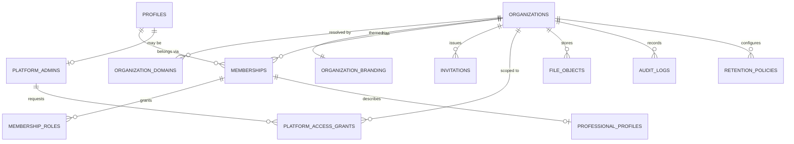
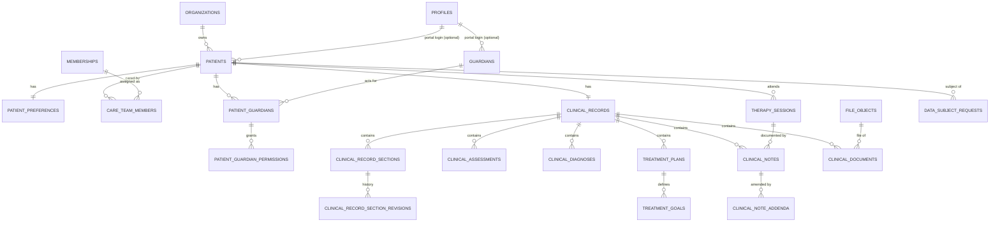
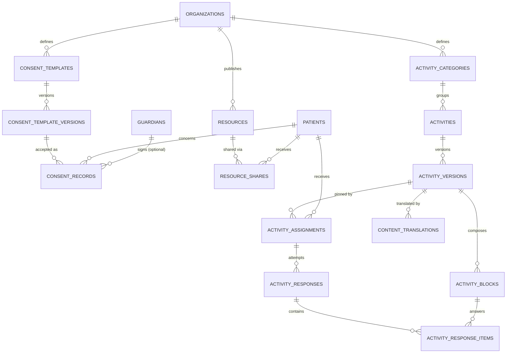

# Database — Logical Model

> Status: **Phase 0 — Proposed.** This is a logical model for review.
> **No production migrations exist yet.** No SQL has been written; backend implements
> migrations in Phase 1 from this document after client + security approval.
> Related: [ARCHITECTURE.md](./ARCHITECTURE.md) · [API_CONTRACTS.md](./API_CONTRACTS.md) · [DECISIONS.md](./DECISIONS.md)

Markers: `[NEEDS PSYCHOLOGIST INPUT]` (clinical content to confirm with Daniela),
`[NEEDS LEGAL VERIFICATION]` (depends on Colombian law), `[SECURITY REVIEW]`.

---

## 1. Global rules

1. **PKs**: `id uuid primary key default gen_random_uuid()` (except `audit_logs.seq`, see §9).
2. **Tenancy column**: every tenant-owned table has `organization_id uuid not null
   references organizations(id)`. Exceptions (non-tenant): `organizations`, `profiles`,
   `platform_admins`, `idempotency_keys` (nullable org), `audit_logs` (nullable org for
   platform events).
3. **Cross-tenant reference safety**: every tenant table declares
   `unique (organization_id, id)`, and child FKs are **composite**:
   `foreign key (organization_id, patient_id) references patients (organization_id, id)`.
   A row can therefore never point at a parent in a different organization, even if
   application code is wrong.
4. **Timestamps**: `created_at timestamptz not null default now()`, `updated_at
   timestamptz not null default now()` maintained by a shared trigger. Immutable tables
   have no `updated_at`.
5. **Actors**: `created_by uuid references profiles(id)` on authored rows. Clinical
   authorship uses `author_membership_id` (the person *in that org*).
6. **Text**: human free text as `text` with `check (char_length(x) <= N)`; emails as
   `citext`. Rich clinical / therapeutic text as **restricted rich-text AST** (`jsonb`,
   `check (jsonb_typeof(x) = 'object')`, validated by Zod in the app). One AST per field —
   never a whole record in one JSON document (structured data requirement).
7. **RLS**: enabled and forced on every table. Policies use helpers in schema `app`
   (`STABLE`, `set search_path = ''`, `SECURITY DEFINER` only where they must read tables
   the caller cannot). Intent per table below; draft policy sketches live in SECURITY.md §4.4.
8. **Indexes**: every FK column is indexed (composite with `organization_id` first where
   queries are tenant-scoped).
9. **Enums**: Postgres enum types (list in §3). Adding values is a migration; removing is
   forbidden (deprecate instead).
10. **Access path (ADR-019, Proposed).** This model must be safe under both options of
    ADR-019. Under the recommended Option A the Data API is disabled for domain schemas and
    the server queries Postgres as `authenticated` with the verified JWT claims; under
    Option B the column splits marked **[B]** below become mandatory. Tables marked
    **[split]** are separated in either case because they are cheap and protect against DAL
    mistakes (consent evidence, guardian safety caveats, patient-facing goal text).
11. **Views** are always created `with (security_invoker = true, security_barrier = true)`
    (F-05); a migration lint rejects any other view. A projection for a role that has **no**
    row access to the base table (e.g. owner patient directory) is a `SECURITY DEFINER`
    function in schema `app` with explicit checks returning only the allowed columns — never
    a view.
12. **Integrity rules in the DB, not only Zod** (F-10): state transitions, actor rules and
    cross-row invariants that protect clinical or consent meaning are enforced by triggers or
    by the Postgres function that performs the write; Zod remains the first validation layer.

### RLS helper functions (intent)

Rules for all helpers (SECURITY.md §4.3): schema `app` is **not exposed** through any API;
`execute` revoked from `public`/`anon`; identity always derived inside (`auth.uid()`,
`auth.jwt()`), never passed as a parameter; return `boolean` only; every staff, clinical and
platform helper requires `aal2` (F-03); every helper requires the organization to be in an
allowed status (§5.1) and memberships/relationships to be `active`.

| Function | Returns true when |
|---|---|
| `app.is_aal2()` | `auth.jwt()->>'aal' = 'aal2'` |
| `app.my_membership_id(org)` | (returns uuid) caller's active membership id in org, else null |
| `app.is_org_member(org)` | aal2 ∧ active membership ∧ org readable |
| `app.has_org_role(org, role)` | `is_org_member` ∧ role held |
| `app.can_write_clinical(org, patient)` | aal2 ∧ membership with `psychologist` role ∧ active `care_team_members` row ∧ org `active` |
| `app.can_read_clinical(org, patient)` | `can_write_clinical` (org `active` or `read_only`) **or** an **approved, active** break-glass grant for this admin and patient (§5.1) — break-glass never satisfies `can_write_clinical` (F-02) |
| `app.is_patient_self(org, patient, need)` | `patients.profile_id = auth.uid()` ∧ org `active` ∧ patient status allows `need` (`portal_read`, `portal_write`) per §5.3 table |
| `app.guardian_can(org, patient, permission)` | guardian `active` ∧ relationship `active`, verified, within validity ∧ unrevoked permission row ∧ patient **is a minor** (`app.is_minor`) ∧ patient status allows portal ∧ org `active` |
| `app.is_platform_admin()` | aal2 ∧ unrevoked `platform_admins` row — used **only** for non-clinical platform tables |
| `app.can_read_file(file_id)` | delegates to the owning entity's helper |

---

## 2. Entity refinements (vs. initial conceptual list)

| Initial | Result | Justification |
|---|---|---|
| `psychologists` | **`professional_profiles`** (1:1 with membership) | A person can be a psychologist in several orgs with different titles/licence display; clinical authority is per membership. Also future non-psychologist professionals. |
| `memberships` | `memberships` + **`membership_roles`** | Daniela is both `organization_owner` and `psychologist`; multiple roles per membership without duplicating membership rows. |
| `patient_access` | Split into **`care_team_members`** + `patients.profile_id` | "Access" conflated two things: (a) which psychologists may see a patient (care team, time-bounded, audited) and (b) the patient's own portal login (a nullable link). |
| `guardians`, `patient_guardians` | Kept; plus **`patient_guardian_permissions`** | Guardian is an org-scoped person record (may exist before having a login); relationship is per patient with validity & legal-representative flag; permissions are granular rows, revocable with history. |
| `guardian_consents`, `consents` | Merged into **`consent_records`**, with new **`consent_templates`** + **`consent_template_versions`** | One evidence table with `signer_type` (patient / guardian / professional-recorded). Template versions give immutable text + hash. |
| `clinical_record_sections` | Kept + **`clinical_record_section_revisions`** | Sections are living documents; every change keeps the previous content (traceability). |
| `treatment_plans` | Kept (versioned, supersedes chain) + **`treatment_goals`** | Goals are structured, individually trackable rows. |
| `sessions` | Renamed **`therapy_sessions`** | Avoid collision with auth sessions in code, logs and RLS discussions. |
| `session_notes` | Renamed **`clinical_notes`** + **`clinical_note_addenda`** | Notes are not always tied to a session (intake, phone contact, closure). Addenda implement correction-without-overwrite. |
| `clinical_documents` | Kept + generic **`file_objects`** | Single storage metadata table (hash, mime, size, path) reused by documents, resources, activity media, consent evidence, branding. |
| `activity_age_ranges` | **Removed** → `age_min_years` / `age_max_years` on `activity_versions` | A lookup table for two integers adds joins without value; ranges are snapshot with the immutable version. |
| `activities` | Split identity (`activities`) from content (`activity_versions`) | Title/objective/instructions are content and must be immutable once published. |
| `resources` | Kept + **`resource_shares`** | Sharing a resource with a patient is an auditable, revocable event. |
| `translations` | Renamed **`content_translations`** | UI strings live in `messages/*.json`; DB table is only for therapeutic content with review status. |
| — | **`organization_domains`** | Host-based tenant resolution & white-label portal. |
| — | **`invitations`** | Staff, patient and guardian onboarding with hashed tokens. |
| — | **`platform_admins`**, **`platform_access_grants`** | platform_admin is not a membership; break-glass is explicit, time-boxed, audited. |
| — | **`data_subject_requests`**, **`retention_policies`** | Habeas data workflow (Ley 1581) and configurable — not hardcoded — retention. `[NEEDS LEGAL VERIFICATION]` |
| — | **`idempotency_keys`** | Safe retries for submissions/consents. |
| `patient_preferences` | Kept | Portal mode (child/adolescent/adult) is suggested from age and confirmed or overridden by the psychologist (PAT-03); never silently changed by the system. |
| — | **`patient_reflections`** | PRT-05 journal; deliberately **not** an activity response so no guardian permission can reach it (F-07). |
| — | **`clinical_document_shares`** | DOC-02/PRT-07: sharing a deliberately authored document is a revocable, audited event, like `resource_shares` (F-08b). |
| — | **`treatment_goal_patient_texts`** [split] | TPL-03/PRT-06: patient-facing wording separate from clinical goal text (F-08b). |
| — | **`activity_response_feedback`** | RSP-05: feedback visible to the patient, separate from private notes and from the immutable response. |
| — | **`consent_record_evidence`** [split] | IP/UA/typed name are care-team only; other guardians never see them (F-09). |
| — | **`patient_guardian_caveats`** [split] | GRD-08 safety caveat visible to the care team only. |
| — | **`portal_supervised_sessions`** | AUTH-07 Option A: guardian-started child session (SECURITY.md §3.4). |
| — | **`mfa_recovery_codes`**, **`rate_limit_counters`** | ADR-021, ADR-020. |

---

## 3. Enums

| Enum | Values |
|---|---|
| `org_status` | `active`, `read_only`, `suspended`, `closed` (behaviour in §5.1) |
| `domain_type` | `subdomain`, `custom` |
| `membership_status` | `active`, `suspended`, `removed` |
| `membership_role` | `organization_owner`, `psychologist` |
| `invitation_type` | `staff`, `patient`, `guardian` |
| `invitation_status` | `pending`, `accepted`, `revoked`, `expired` |
| `document_type` | `cc`, `ti`, `rc`, `ce`, `pa`, `ppt`, `nit`, `other` (Colombian ID types) `[NEEDS LEGAL VERIFICATION]` |
| `patient_status` | `intake`, `active`, `paused`, `discharged`, `archived` (PRD PAT-05; access per §5.3) |
| `portal_mode` | `child`, `adolescent`, `adult` (PRD PAT-03/PRT-03) |
| `care_role` | `primary`, `secondary`, `supervisor` `[NEEDS PSYCHOLOGIST INPUT]` |
| `guardian_relationship` | `mother`, `father`, `legal_guardian`, `grandparent`, `other_relative`, `other` |
| `relationship_status` | `pending_verification`, `active`, `suspended`, `revoked` |
| `relationship_suspension_reason` | `age_of_majority`, `custody_review`, `safety_concern`, `other` |
| `legal_representation_basis` | `parental_authority`, `legal_guardianship`, `court_order`, `other` `[NEEDS LEGAL VERIFICATION]` |
| `guardian_permission` | `view_assignments`, `complete_assignments`, `view_responses`, `view_shared_resources`, `sign_consents`, `view_session_schedule`, `manage_portal_preferences`, `receive_notifications`, `view_shared_documents`, `view_patient_facing_goals` (PRD GRD-04) |
| `record_status` | `open`, `closed` |
| `record_section_key` | `consultation_reason`, `current_problem`, `personal_history`, `family_history`, `developmental_history`, `school_work_history`, `social_history`, `medical_history`, `mental_status_exam`, `case_formulation`, `other` `[NEEDS PSYCHOLOGIST INPUT]` |
| `entry_status` | `draft`, `finalized` (assessments, notes) |
| `code_system` | `cie10`, `cie11`, `dsm5tr`, `other` |
| `diagnosis_status` | `provisional`, `confirmed`, `ruled_out`, `resolved` |
| `plan_status` | `draft`, `active`, `completed`, `superseded`, `discontinued` |
| `goal_status` | `open`, `in_progress`, `achieved`, `discontinued` (PRD TPL-03) |
| `session_status` | `scheduled`, `held`, `cancelled_by_patient`, `cancelled_by_psychologist`, `no_show` (PRD SES-04) |
| `session_modality` | `in_person`, `remote_external`, `phone` (remote = outside the system; no video in MVP) |
| `note_type` | `intake`, `session_progress`, `contact`, `closure`, `general` |
| `addendum_reason` | `correction`, `clarification`, `late_entry`, `other` |
| `file_bucket` | `clinical-documents`, `activity-media`, `resources`, `branding`, `exports` |
| `file_status` | `pending_upload`, `ready`, `quarantined`, `deleted` |
| `clinical_document_type` | `referral`, `report`, `external_evaluation`, `consent_scan`, `certificate`, `other` |
| `consent_type` | `treatment_informed_consent`, `personal_data_processing`, `minor_assent`, `guardian_authorization`, `portal_use`, `other` `[NEEDS LEGAL VERIFICATION]` |
| `publish_status` | `draft`, `published`, `retired` (consent template versions, activity versions) |
| `signer_type` | `patient`, `guardian`, `professional_recorded` |
| `consent_method` | `portal_checkbox`, `portal_typed_name`, `paper_scan`, `verbal_recorded` |
| `consent_decision` | `accepted`, `declined` |
| `consent_record_status` | `accepted`, `declined`, `withdrawn` (derived column, PRD CON-04) |
| `content_status` | `draft`, `published`, `archived` (resources, activities) |
| `resource_type` | `file`, `link`, `video_embed`, `audio` |
| `audience` | `adult`, `adolescent`, `child`, `any` |
| `block_type` | `text`, `image`, `multiple_choice`, `open_response`, `scale`, `emotion_selector`, `audio`, `video`, `game` |
| `assignment_status` | `assigned`, `in_progress`, `submitted`, `reviewed`, `withdrawn` (PRD ASG-04; "overdue" is derived from `due_at`, not a status) |
| `guardian_visibility` | `none`, `assignment_only`, `assignment_and_responses` |
| `response_status` | `in_progress`, `submitted` |
| `response_actor` | `patient`, `guardian`, `professional_in_session` |
| `translatable_entity` | `activity_version`, `activity_block`, `resource`, `activity_category` |
| `translation_status` | `draft`, `in_review`, `approved`, `rejected` |
| `dsr_type` | `access`, `rectification`, `update`, `suppression`, `revoke_authorization`, `other` `[NEEDS LEGAL VERIFICATION]` |
| `dsr_status` | `received`, `in_review`, `fulfilled`, `partially_fulfilled`, `rejected` |
| `grant_scope` | `org_support_non_clinical`, `clinical_read_break_glass` |
| `grant_status` | `pending`, `approved`, `rejected`, `revoked`, `expired` |
| `actor_type` | `user`, `system`, `platform_admin`, `break_glass` |

---

## 4. ER overview

Diagrams show the core entities; tables added after security review v0.1 are listed in §2.

### 4.1 Tenancy & identity

### 4.2 Patients, guardians & clinical

### 4.3 Consents, resources & activities

---

## 5. Tables

Notation: **Cols** = key columns (not exhaustive; all have `id`, timestamps, and
`organization_id` unless stated). **C** = constraints. **Idx** = indexes beyond FK
indexes. **RLS** = one-line intent.

### 5.1 Tenancy & platform

#### `organizations` (tenant root, no `organization_id`)
Purpose: a practice/clinical brand (tenant).
- Cols: `slug text`, `legal_name text`, `display_name text`, `tax_id text null` (NIT),
  `country_code char(2) default 'CO'`, `default_locale text default 'es'`,
  `time_zone text default 'America/Bogota'`, `status org_status`.
- C: `unique(slug)`, `check (slug ~ '^[a-z0-9-]{3,48}$')`, `check (default_locale in ('es','en'))`.
- RLS: members read own org; owners update non-critical fields; platform admin reads/creates metadata (no clinical joins).
- **Status behaviour** (F-26; enforced inside every helper, not only in the app):

  | Status | Staff | Portal (patients/guardians) | Notes |
  |---|---|---|---|
  | `active` | normal | normal | — |
  | `read_only` | read (incl. clinical for care team), no writes except exports by care team | denied (neutral notice page) | Grace/offboarding state (e.g. non-payment) so clinical custody is not interrupted `[NEEDS LEGAL VERIFICATION]` |
  | `suspended` | denied | denied | Security incident or legal order; platform admin sees metadata only |
  | `closed` | denied; care-team export only via the offboarding procedure (service-role job, audited) | denied | Custody/handover of records `[NEEDS LEGAL VERIFICATION]` |

#### `organization_domains`
Purpose: host → org mapping for white-label tenant resolution.
- Cols: `host citext`, `domain_type domain_type`, `is_primary bool`, `verified_at timestamptz null`.
- C: `unique(host)`; partial unique `(organization_id) where is_primary`.
- RLS: owners manage; middleware lookup via a restricted `SECURITY DEFINER` function returning only `organization_id` for verified hosts.

#### `organization_branding` (1:1)
Purpose: white-label tokens.
- Cols: `organization_id uuid PK/FK`, `display_name text`, `logo_file_id uuid null`,
  `favicon_file_id uuid null`, `color_primary text`, `color_primary_fg text`,
  `color_accent text`, `color_accent_fg text`, `radius_scale smallint`,
  `font_family text`, `portal_welcome_es text null`, `portal_welcome_en text null`.
- C: `check` color format (`^\d{1,3} \d{1,3}% \d{1,3}%$` HSL), `font_family` in allowlist, contrast validated in app.
- RLS: readable by anyone resolved to the org (incl. pre-auth via function); owners update.

#### `platform_admins` (no `organization_id`)
- Cols: `profile_id uuid PK FK profiles`, `granted_by`, `granted_at`, `revoked_at null`.
- RLS: no tenant access; only service role / platform admins read.

#### `platform_access_grants`
Purpose: approval-gated, time-boxed elevation for a platform admin (ADR-014, SECURITY.md §6, PRD SEC-14).
- Cols: `platform_admin_profile_id` (requester), `scope grant_scope`, `patient_id uuid null`,
  `object_scope jsonb null` (ids only, optional narrowing to specific records),
  `reason text not null`, `ticket_reference text not null`, `requested_duration interval`,
  `status grant_status default 'pending'`,
  `owner_approved_by_profile_id null`, `owner_approved_at null`,
  `psychologist_approval_required bool`, `psychologist_approved_by_membership_id null`, `psychologist_approved_at null`,
  `second_approver_profile_id null`, `second_approved_at null`,
  `starts_at null`, `expires_at null`, `revoked_at null`, `revoked_by_profile_id null`,
  `report_sent_at null`.
- C: `check (char_length(reason) >= 20)`; `clinical_read_break_glass` ⇒ `patient_id is not null`;
  `requested_duration <= max_break_glass_duration` (constant, **default and max 4 h**, configurable
  only downward without a new ADR); `second_approver_profile_id <> platform_admin_profile_id`;
  `status = 'approved'` ⇒ owner approval ∧ second approval ∧ (psychologist approval when required)
  ∧ `starts_at`/`expires_at` set.
- **Activation is done by the database, not the requester**: a trigger sets `status = 'approved'`,
  `starts_at = now()` and `expires_at = now() + requested_duration` only when the last required
  approval arrives; the requester cannot update approval columns (column checks in the
  approval functions `app.approve_grant_as_owner/psychologist/second_admin`, each `aal2`,
  each rejecting self-approval). `psychologist_approval_required` is set at request time when the
  patient's primary psychologist is not the approving owner `[NEEDS PSYCHOLOGIST INPUT]`.
- Read-only by construction: grants are consulted only by `app.can_read_clinical`; no write
  helper, export, or `exports` signed URL ever accepts a grant.
- Revocation: owner, treating psychologist or either SyV approver (one-time `revoked_*`).
  Expiry job sets `expired` and triggers the access report to the owner.
- Idx: `(platform_admin_profile_id, status, expires_at)`, `(organization_id, status)`.
- RLS: requester inserts `pending` rows only; org owners (and the treating psychologist) read
  grants for their org and approve via functions; platform admins read grants they requested
  or must second-approve. Every use is audited with `break_glass_grant_id`.

### 5.2 Identity & membership

#### `profiles` (no `organization_id`)
Purpose: one row per auth user; person-level settings.
- Cols: `id uuid PK = auth.users.id`, `display_name text`, `locale text null`,
  `time_zone text null`, `last_seen_at timestamptz null`.
- RLS: self read/update; co-members of an org read `display_name` via the
  `SECURITY DEFINER` function `app.org_member_directory(org)` (not a view, F-05).

#### `memberships`
Purpose: profile ↔ organization (staff only; patients/guardians are not members).
- Cols: `profile_id`, `status membership_status`, `joined_at`, `removed_at null`.
- C: `unique(organization_id, profile_id)`.
- RLS: members read org memberships; owners manage; cannot remove the last owner (trigger).

#### `membership_roles`
- Cols: `membership_id`, `role membership_role`, `granted_by`, `granted_at`.
- C: `unique(membership_id, role)`.
- RLS: members read; owners manage via function.
- **Self-grant of `psychologist`** (F-06) is enforced **in the DB**: a trigger requires a
  `professional_profiles` row with licence data for that membership; when grantor = grantee it
  writes `membership.role_self_granted` and notifies other owners/psychologists of the org.
  Cannot remove the last `organization_owner` (trigger).

#### `professional_profiles` (renamed from `psychologists`)
- Cols: `membership_id unique`, `professional_title text`, `license_number text`
  (tarjeta profesional), `license_issuer text`, `specialties text[]`,
  `signature_file_id uuid null`.
- C: `unique(organization_id, license_number)`.
- RLS: org members read; self + owners update.

#### `invitations`
- Cols: `invitation_type`, `email citext`, `roles membership_role[] null` (staff),
  `patient_id null`, `guardian_id null`, `token_hash bytea`, `expires_at`,
  `status invitation_status`, `invited_by`, `accepted_by_profile_id null`, `accepted_at null`.
- C: `unique(token_hash)`; check type ↔ target (`staff` ⇒ roles not empty; `patient` ⇒ patient_id; `guardian` ⇒ guardian_id + patient_id).
- Idx: `(organization_id, email, status)`.
- RLS: owners (staff) / care-team psychologists (patient, guardian) create & read; acceptance via service-role function only. Raw token never stored.

### 5.3 Patients & guardians

#### `patients`
Purpose: patient demographic identity within an org.
- Cols: `profile_id uuid null` (portal login), `first_name`, `last_name`,
  `preferred_name null`, `date_of_birth date`, `document_type`, `document_number text null`,
  `email citext null`, `phone text null`, `sex text null`, `gender_identity text null`
  `[NEEDS PSYCHOLOGIST INPUT]`, `status patient_status`, `archived_at null`, `created_by`.
- C: partial unique `(organization_id, document_type, document_number) where document_number is not null`;
  partial unique `(organization_id, profile_id) where profile_id is not null`;
  `check (date_of_birth <= current_date)`.
- Idx: `(organization_id, last_name, first_name)`, `(organization_id, status)`.
- Minor status is **derived** (`app.is_minor(date_of_birth, country)`), never stored, with age-of-majority as configuration. `[NEEDS LEGAL VERIFICATION]`
- C (PAT-02/CON-05, F-10): status may leave `intake` only through `app.activate_patient()`,
  which checks required consents and, for minors, at least one `active` legal-representative
  relationship with verified basis. `profile_id` may not belong to a profile with an active
  membership in the same org (no staff ↔ patient in one org, F-21; trigger).
- RLS: care team full read/update; owners get **directory fields only** through
  `app.patient_directory(org)` (SECURITY DEFINER function, Q-03); patient reads own row (DTO
  limits fields); guardians get name/preferred name only through
  `app.guardian_patient_summary()`. **[B]** split `document_type/number`, `email`, `phone`,
  `sex`, `gender_identity` into care-team-only `patient_identifiers`.
- **Portal access per patient status** (F-20; enforced in `app.is_patient_self` / `app.guardian_can`):

  | Status | Portal read | Portal write (respond, reflect) | New assignments | Notes |
  |---|---|---|---|---|
  | `intake` | onboarding only: consents, privacy, safety info | sign consents/assent | no | PAT-02 gating |
  | `active` | yes | yes | yes | — |
  | `paused` | yes | existing assignments, reflections | no | `[NEEDS PSYCHOLOGIST INPUT]` |
  | `discharged` | consents list, account, DSR | no | no | Record read-only for staff (PAT-05) |
  | `archived` | no (neutral notice) | no | no | DSR via practice contact |

#### `patient_preferences` (1:1)
- Cols: `patient_id unique`, `portal_mode portal_mode` (suggested from age, set by psychologist), `locale text null`,
  `notify_email bool`, `text_size smallint`, `reduced_motion bool`, `audio_instructions bool`.
- RLS: care team manages `portal_mode`; patient (and guardians with `manage_portal_preferences`) update accessibility/notification fields only (column-level via function).

#### `care_team_members` (replaces `patient_access`)
Purpose: which psychologist memberships have clinical access to which patient.
- Cols: `patient_id`, `membership_id`, `care_role care_role`, `starts_at`, `ends_at null`,
  `assigned_by`, `end_reason text null`.
- C: partial unique `(patient_id, membership_id) where ends_at is null`;
  partial unique `(patient_id) where care_role = 'primary' and ends_at is null`;
  membership must hold `psychologist` role (trigger).
- Idx: `(organization_id, membership_id) where ends_at is null`.
- RLS: care team + owners read; assign/end via `app.assign_care_team_member()` only. Never hard-deleted.
- **Owner self-assignment** (F-06): when the assigner assigns their own membership to a patient
  who already has a different `primary`, the function requires `reason`, notifies the primary
  psychologist, and writes `care_team.self_assigned` (highlighted in the patient's access
  history). Whether the primary must acknowledge before access starts: `[NEEDS PSYCHOLOGIST INPUT]`
  (default proposal: acknowledgement required). Solo practices are unaffected.

#### `guardians`
Purpose: adult acting for a patient; org-scoped person record, may exist before login.
- Cols: `profile_id uuid null`, `first_name`, `last_name`, `document_type`,
  `document_number null`, `email citext null`, `phone null`, `status` (`active`/`inactive`).
- C: partial unique `(organization_id, profile_id)`; partial unique `(organization_id, document_type, document_number)`;
  `profile_id` may not hold an active membership in the same org (trigger, F-21) `[NEEDS PSYCHOLOGIST INPUT]`.
- RLS: care team of any linked patient reads/updates; guardian reads self. Guardians never read
  other guardians' rows.

#### `patient_guardians`
Purpose: the relationship that scopes all guardian access.
- Cols: `patient_id`, `guardian_id`, `relationship guardian_relationship`,
  `is_legal_representative bool`, `legal_basis legal_representation_basis null`,
  `legal_basis_file_id uuid null` (supporting document, `clinical-documents`),
  `legal_basis_verified_by_membership_id null`, `legal_basis_verified_at null`,
  `is_primary_contact bool default false`, `status relationship_status`,
  `suspension_reason relationship_suspension_reason null`, `valid_from date`,
  `valid_until date null`, `verified_by null`, `verified_at null`,
  `verification_note text null`, `revoked_by null`, `revoked_at null`, `revoke_reason null`.
- C (GRD-02/03, F-12): `unique(patient_id, guardian_id)`; `check (valid_until is null or valid_until >= valid_from)`;
  `status = 'active'` ⇒ `verified_at is not null`; `is_legal_representative` ⇒ `legal_basis is not null`;
  `status = 'suspended'` ⇔ `suspension_reason is not null`; partial unique `(patient_id) where is_primary_contact and status = 'active'`.
- RLS: care team manages; guardian reads **own** relationships via DTO (no verification notes).
- **Age of majority** (F-08, PRD PAT-06, fail-closed): a daily job creates a care-team task 60
  days before the derived 18th birthday; on the day it sets every `active` relationship of
  that patient to `suspended` (`age_of_majority`) and notifies the care team. Independently,
  `app.guardian_can` returns false once `app.is_minor` is false, so access stops even if the
  job is late. Reactivation requires the adult patient's own consent record and a
  psychologist action. Threshold is configuration `[NEEDS LEGAL VERIFICATION]`.

#### `patient_guardian_caveats` [split] (GRD-08)
- Cols: `patient_guardian_id`, `caveat text`, `restrict_schedule bool`, `created_by_membership_id`, `ended_at null`.
- RLS: care team only. When active with `restrict_schedule`, `app.set_guardian_permissions()`
  refuses `view_session_schedule` and the UI warns before any share.

#### `portal_supervised_sessions` (AUTH-07 Option A)
- Cols: `guardian_profile_id`, `patient_id`, `patient_guardian_id`, `started_at`, `expires_at`,
  `last_activity_at`, `ended_at null`.
- C: insert only via `app.start_supervised_session()` which requires
  `app.guardian_can(..., 'complete_assignments')`; idle 20 min / absolute 60 min (constants).
- RLS: the guardian reads own; care team reads. Checked on every request; permission
  revocation ends it.

#### `patient_guardian_permissions`
Purpose: granular, revocable permission grants per relationship.
- Cols: `patient_guardian_id`, `permission guardian_permission`, `granted_by`, `granted_at`,
  `revoked_by null`, `revoked_at null`.
- C: partial unique `(patient_guardian_id, permission) where revoked_at is null`.
  Rows are never updated except setting `revoked_*` once (trigger); re-grant = new row.
- RLS: care team manages via `app.set_guardian_permissions()`; guardian reads own grants.
  Enabling `view_responses` for an adolescent writes a distinct audit flag (SECURITY.md §5.3).

### 5.4 Clinical

All clinical tables: **SELECT = `app.can_read_clinical(org, patient_id)`; INSERT/UPDATE =
`app.can_write_clinical(org, patient_id)`** (F-02 split; break-glass is read-only by
construction). Patients, guardians, owners-without-care-team and platform admins (without an
approved grant) have **no policy** → no access. `aal2` is required inside the helpers (F-03).
Every read is audited by the DAL. Patient-visible derivatives (patient-facing goal text,
document shares) live in **separate** tables with their own policies.

#### `clinical_records`
- Cols: `patient_id`, `record_number text`, `status record_status`, `opened_at`,
  `opened_by_membership_id`, `closed_at null`, `closure_summary jsonb null`.
- C: `unique(organization_id, patient_id)` (one record per patient per org; episodes = open question Q-12); `unique(organization_id, record_number)`.

#### `clinical_record_sections`
- Cols: `clinical_record_id`, `patient_id`, `section_key record_section_key`,
  `content jsonb` (rich-text AST), `content_locale text`, `revision int`,
  `last_edited_by_membership_id`.
- C: `unique(clinical_record_id, section_key)` (except `other`, which allows many via `title`).
- Trigger: on UPDATE, copy previous row to `clinical_record_section_revisions` and increment `revision`. No DELETE.

#### `clinical_record_section_revisions` (append-only)
- Cols: `section_id`, `revision int`, `content jsonb`, `edited_by_membership_id`, `edited_at`.
- C: `unique(section_id, revision)`. UPDATE/DELETE blocked.

#### `clinical_assessments`
Purpose: psychologist-entered assessment records (no scoring engine).
- Cols: `clinical_record_id`, `patient_id`, `assessed_on date`, `instrument_name text`,
  `instrument_reference text null`, `results jsonb` (AST), `interpretation jsonb` (AST),
  `attachment_file_id null`, `status entry_status`, `finalized_at null`, `finalized_by null`,
  `content_hash bytea null`, `author_membership_id`.
- Immutability: same rules as notes (finalized ⇒ frozen; corrections via addendum-like
  follow-up assessment referencing `corrects_assessment_id`).

#### `clinical_diagnoses`
Purpose: professional-entered diagnostic impressions.
- Cols: `clinical_record_id`, `patient_id`, `code_system`, `code text`, `label text`,
  `status diagnosis_status`, `diagnosed_on date`, `resolved_on date null`, `notes jsonb null`,
  `recorded_by_membership_id`.
- C: `check (resolved_on is null or resolved_on >= diagnosed_on)`.
- Updates limited to `status`, `resolved_on` (trigger); `code`/`label` changes require a new row; full history in audit log.

#### `treatment_plans`
- Cols: `clinical_record_id`, `patient_id`, `version int`, `status plan_status`,
  `supersedes_plan_id null`, `summary jsonb`, `start_date`, `review_date null`,
  `author_membership_id`, `activated_at null`.
- C: `unique(clinical_record_id, version)`; partial unique `(clinical_record_id) where status = 'active'`.
- Once `active`, content columns frozen; changes create a new version that supersedes it.

#### `treatment_goals`
- Cols: `treatment_plan_id`, `position smallint`, `description jsonb` (clinical wording),
  `status goal_status`, `target_date null`, `achieved_at null`.
- Content frozen with its plan; `status`/`achieved_at` updatable while plan active (progress tracking).

#### `treatment_goal_patient_texts` [split] (TPL-03, PRT-06, F-08b)
- Cols: `treatment_goal_id unique`, `patient_id`, `patient_facing_text jsonb` (AST written by
  the psychologist), `published_at null`, `withdrawn_at null`, `author_membership_id`.
- Frozen with its plan (new plan version copies rows). Status shown to the patient is the
  goal's `status`, read through `app.portal_patient_goals(patient)` (SECURITY DEFINER,
  returns text + status only, active plan only).
- RLS: care team manages; patient self (`portal_read`); guardian with `view_patient_facing_goals`.
  The clinical `description` is never reachable from the portal.

#### `therapy_sessions` (renamed from `sessions`)
- Cols: `patient_id`, `psychologist_membership_id`, `scheduled_start timestamptz`,
  `scheduled_end timestamptz`, `status session_status`, `modality session_modality`,
  `cancelled_reason text null`, `location_or_link text null` (SES-06, external only).
- C: `check (scheduled_end > scheduled_start)`; `cancelled_reason` only for `cancelled_*`.
- Idx: `(organization_id, psychologist_membership_id, scheduled_start)`, `(organization_id, patient_id, scheduled_start desc)`.
- RLS: clinical access; the patient and guardians with `view_session_schedule` get date/time/status
  only through `app.portal_upcoming_sessions(patient)` (SECURITY DEFINER, explicit checks,
  blocked by an active schedule caveat).

#### `clinical_notes` (renamed from `session_notes`)
- Cols: `clinical_record_id`, `patient_id`, `therapy_session_id null`, `note_type`,
  `body jsonb` (AST), `content_locale`, `status entry_status`, `author_membership_id`,
  `finalized_at null`, `finalized_by_membership_id null`, `content_hash bytea null`.
- C: `status = 'finalized'` ⇔ `finalized_at`, `finalized_by`, `content_hash` not null.
- Idx: `(organization_id, patient_id, created_at desc)`.
- Trigger: UPDATE/DELETE rejected when `OLD.status = 'finalized'` (§6); finalization is
  self-validating (finalizer = author = caller, server timestamp, hash recomputed, body
  unchanged — SECURITY.md §4.4f). **Never visible to patients or guardians.**
- Drafts (F-13, NOTE-02): INSERT/UPDATE policy requires `author_membership_id =
  app.my_membership_id(org)` **and** `can_write_clinical`. Draft **read** by other care-team
  members: default **author only** `[NEEDS PSYCHOLOGIST INPUT]`.

#### `clinical_note_addenda` (append-only)
- Cols: `clinical_note_id`, `patient_id`, `reason addendum_reason`, `body jsonb`,
  `author_membership_id`, `content_hash bytea`, `created_at`.
- C: parent note must be finalized (trigger). UPDATE/DELETE blocked.

#### `file_objects`
Purpose: metadata of every storage object.
- Cols: `bucket file_bucket`, `storage_path text`, `mime_type text`, `size_bytes bigint`,
  `sha256 bytea null`, `display_name text` (sanitized), `status file_status`,
  `uploaded_by`, `deleted_at null`.
- C: `unique(bucket, storage_path)`; `check (storage_path like 'org/' || organization_id || '/%')`.
- RLS: inherits from the owning entity via helper `app.can_read_file(file_id)`.

#### `clinical_documents`
- Cols: `clinical_record_id`, `patient_id`, `file_object_id`, `document_type`, `title`,
  `document_date date null`, `description text null`, `supersedes_document_id null`,
  `uploaded_by_membership_id`, `archived_at null`.
- File content immutable; replacement = new document with `supersedes_document_id`.
- Private by default; patient visibility only via `clinical_document_shares`.

#### `clinical_document_shares` (DOC-02, PRT-07, F-08b)
- Cols: `clinical_document_id`, `patient_id`, `shared_by_membership_id`, `shared_at`,
  `guardian_visible bool default false`, `revoked_at null`, `revoked_by_membership_id null`.
- C: partial unique `(clinical_document_id, patient_id) where revoked_at is null`; document
  must belong to the same patient (composite FK); `clinical_notes` can never be shared (no FK path, NOTE-04).
- RLS: care team manages; patient self (`portal_read`); guardian with `view_shared_documents`
  ∧ `guardian_visible`. `app.can_read_file` honours an active share; every view/URL audited.

### 5.5 Consents

#### `consent_templates`
- Cols: `key text`, `consent_type`, `title text`, `signer_requirement`
  (`patient`/`guardian`/`patient_and_guardian`), `applies_to_minors bool`, `status content_status`.
- C: `unique(organization_id, key)`.
- RLS: org members read; owners manage.

#### `consent_template_versions`
- Cols: `consent_template_id`, `version_number int`, `locale text`, `body jsonb` (AST),
  `body_hash bytea` (sha256 of canonical serialization), `status publish_status`,
  `published_at null`, `published_by null`, `legal_review_reference text null`.
- C: `unique(consent_template_id, version_number, locale)`.
- Immutable after publish (trigger, only `published → retired` allowed).
- RLS: org members read; patients/guardians read published versions they are asked to sign.

#### `consent_records` (merges `consents` + `guardian_consents`)
Purpose: a consent decision (who, what, which version, how).
- Cols: `patient_id`, `consent_template_version_id`, `signer_type`,
  `signer_profile_id null`, `signer_guardian_id null`, `patient_guardian_id null`,
  `recorded_by_profile_id`, `decision consent_decision`, `method consent_method`,
  `locale text`, `text_hash bytea`, `accepted_at timestamptz` (server time),
  `evidence_file_id uuid null`, `withdrawn_at null`, `withdrawn_by_profile_id null`,
  `withdrawal_reason text null`,
  `status consent_record_status generated always as (withdrawn → declined → accepted) stored`.
- C: `text_hash` must equal the version's `body_hash` (trigger); `method = 'paper_scan'` ⇒
  `evidence_file_id not null`; `signer_type = 'guardian'` ⇒ guardian ids not null and, at signing
  time, relationship `active` ∧ `sign_consents` ∧ (for `treatment_informed_consent`,
  `guardian_authorization`, `personal_data_processing`) `is_legal_representative` with
  `legal_basis_verified_at` set (F-12, GRD-03); `minor_assent` ⇒ `signer_type = 'patient'`.
- Writes only via `app.sign_consent()` / `app.record_consent()` (enforce the above, capture
  evidence). Immutable except one-time `withdrawn_*` (trigger). Re-consent = new row.
  Withdrawal blocks new assignments for the patient until the psychologist resolves (CON-04; trigger on `activity_assignments`).
- Idx: `(organization_id, patient_id, consent_template_version_id)`.
- RLS: care team reads/creates; patient reads own; **guardian reads only records they signed**
  (F-09) — never other signers' records or evidence.

#### `consent_record_evidence` [split] (F-09)
- Cols: `consent_record_id unique`, `typed_name text null`, `ip_address inet null`, `user_agent text null`.
- C: `method = 'portal_typed_name'` ⇒ `typed_name not null` (checked in `app.sign_consent`). Insert-only.
- RLS: care team only. The signer sees a confirmation DTO, not the stored evidence.

### 5.6 Resources & activities

#### `resources`
- Cols: `title`, `description`, `resource_type`, `file_object_id null`, `url text null`,
  `embed_provider text null`, `embed_id text null`, `audience`, `content_locale`,
  `status content_status`, `created_by`.
- C: exactly one of file / url / embed per type; `url ~ '^https://'`; `embed_provider` in allowlist.
- RLS: org members manage; patients/guardians read only through active `resource_shares`.

#### `resource_shares`
- Cols: `resource_id`, `patient_id`, `shared_by_membership_id`, `shared_at`,
  `guardian_visible bool default false`, `message text null`, `revoked_at null`.
- C: partial unique `(resource_id, patient_id) where revoked_at is null`.
- RLS: care team manages; patient reads own; guardian with `view_shared_resources` and `guardian_visible`.

#### `activity_categories`
- Cols: `slug`, `name_es text`, `name_en text`, `position smallint`, `archived_at null`.
- C: `unique(organization_id, slug)`. (Short labels as two columns; no translation workflow needed.)
- RLS: org members read; owners/psychologists manage.

#### `activities`
Purpose: stable identity of an activity across versions.
- Cols: `category_id null`, `internal_name text`, `status content_status`,
  `current_published_version_id null`, `created_by`.
- RLS: org members (psychologists) read/manage; portal users never read directly.

#### `activity_versions`
Purpose: immutable content snapshot once published.
- Cols: `activity_id`, `version_number int`, `status publish_status`, `title`,
  `description`, `therapeutic_objective jsonb`, `instructions jsonb`, `audience`,
  `age_min_years smallint null`, `age_max_years smallint null`, `content_locale`,
  `block_schema_version int`, `content_hash bytea null`, `published_at null`,
  `published_by null`, `created_by`.
- C: `unique(activity_id, version_number)`; partial unique `(activity_id) where status = 'draft'`;
  `check (age_min_years is null or age_max_years is null or age_min_years <= age_max_years)`.
- Immutable once `published` (only `published → retired`).
- RLS: psychologists read/manage drafts; patients/guardians receive only versions pinned by an
  assignment they can see, through `app.portal_activity_version(assignment)` (SECURITY DEFINER,
  omits `therapeutic_objective` — Q-13). **[B]** split professional fields into
  `activity_version_professional_fields`.

#### `activity_blocks`
- Cols: `activity_version_id`, `position smallint`, `block_type`, `schema_version smallint`,
  `config jsonb`, `is_required bool`, `client_key text`.
- C: `unique(activity_version_id, position) deferrable`; `unique(activity_version_id, client_key)`;
  `unique(activity_version_id, id)` (for composite FK from response items); `check (jsonb_typeof(config) = 'object')`.
- Insert/update/delete only while parent version is `draft` (trigger).
- RLS: as parent version.

#### `activity_assignments`
- Cols: `patient_id`, `activity_id`, `activity_version_id` (**pinned**),
  `assigned_by_membership_id`, `assigned_at`, `available_from null`, `due_at null`,
  `status assignment_status`, `guardian_visibility guardian_visibility default 'none'`,
  `allow_multiple_attempts bool`, `message_to_patient text null`, `withdrawn_at null`, `withdrawn_reason null`.
- C: pinned version must be `published` at insert (trigger); `activity_version_id` immutable (trigger); FK `(activity_id, activity_version_id)` consistency;
  insert requires patient status allowing new assignments (§5.3) and no withdrawn required consent (CON-04/05);
  status transitions enforced by trigger (`assigned → in_progress → submitted → reviewed`, any → `withdrawn`; reopen = new attempt, RSP-02).
- Idx: `(organization_id, patient_id, status)`, `(organization_id, assigned_by_membership_id, status)`.
- RLS: care team manages; patient reads own (non-`withdrawn`); guardian with `view_assignments` and `guardian_visibility <> 'none'`.

#### `activity_responses`
- Cols: `activity_assignment_id`, `activity_version_id`, `patient_id`, `attempt_number smallint`,
  `status response_status`, `started_at`, `submitted_at null`, `submitted_by_profile_id null`,
  `submitted_by_actor response_actor null`, `reviewed_at null`, `reviewed_by_membership_id null`.
- C: `unique(activity_assignment_id, attempt_number)`; version equals the assignment's pinned version (composite FK).
- Immutable once `submitted` (only `reviewed_*` set by care team).
- **Writes only via functions** (F-10): direct INSERT/UPDATE on responses and items is revoked for
  `authenticated`; `app.save_response_progress()` and `app.submit_activity_response()` check the
  actor (patient self with `portal_write`, or guardian with `complete_assignments` inside an
  active supervised session), the assignment state, every item against its pinned block
  (value type per `block_type`, option keys ∈ block config, scale within min/max, text ≤
  `maxLength`, `pg_column_size(value)` cap) and that all required blocks are answered; they set
  `submitted_at`, `submitted_by_profile_id`, `submitted_by_actor` server-side.
- RLS (read): patient own; guardian requires `view_responses` **and** `guardian_visibility = 'assignment_and_responses'`; care team reads. Responses **never** create notes automatically.

#### `activity_response_feedback` (RSP-05)
- Cols: `activity_response_id`, `patient_id`, `body jsonb` (AST), `author_membership_id`, `created_at`, `superseded_by_id null`.
- Append-only; edit = new row superseding the previous. Separate from notes; never copied into the record.
- RLS: care team writes/reads; patient self reads latest; guardian follows response visibility
  (`view_responses` ∧ `assignment_and_responses`) `[NEEDS PSYCHOLOGIST INPUT]`.

#### `patient_reflections` (PRT-05, F-07)
- Cols: `patient_id`, `body jsonb` (AST), `created_by_profile_id`, `shared_with_care_team_at null`, `updated_at`.
- C: editable by the patient while not shared; sharing is a one-way explicit action per entry
  (un-share after sharing `[NEEDS PSYCHOLOGIST INPUT]`). Not linkable to assignments or responses.
- RLS: patient self (`portal_write`, never inside a guardian supervised session); care team reads
  **only** shared entries; **no guardian policy, ever, in MVP**; no platform or owner access.
- Whether wholly private entries are stored and their retention `[NEEDS PSYCHOLOGIST INPUT]` `[NEEDS LEGAL VERIFICATION]`.

#### `activity_response_items`
- Cols: `activity_response_id`, `activity_version_id`, `activity_block_id`, `value jsonb`, `answered_at`.
- C: `unique(activity_response_id, activity_block_id)`; composite FK
  `(activity_version_id, activity_block_id) → activity_blocks(activity_version_id, id)`
  guarantees the item answers a block of the pinned version.
- Locked when parent response submitted (trigger).
- RLS: as parent response.

#### `content_translations` (renamed from `translations`)
Purpose: human-authored translations of therapeutic content with review.
- Cols: `entity_type translatable_entity`, `entity_id uuid`, `field_path text`,
  `source_locale`, `target_locale`, `value jsonb`, `status translation_status`,
  `translated_by`, `reviewed_by null`, `reviewed_at null`, `supersedes_id null`,
  `source_content_hash bytea` (detects stale translations).
- C: partial unique `(entity_type, entity_id, field_path, target_locale) where status = 'approved'`;
  `check (source_locale <> target_locale)`. Polymorphic → entity existence + org match enforced by trigger.
- Approved rows immutable; revisions supersede.
- RLS: psychologists manage; portal users read `approved` rows for entities they can read.

### 5.7 Privacy, audit, infrastructure

#### `data_subject_requests`
- Cols: `subject_patient_id null`, `subject_guardian_id null`, `request_type dsr_type`,
  `received_at`, `channel text`, `status dsr_status`, `due_at null` (computed from
  configured policy, not hardcoded), `handled_by_membership_id null`, `resolution_summary text null`,
  `resolved_at null`, `export_file_id null`.
- C: exactly one subject not null.
- RLS: owners + care team of subject read/manage; patient/guardian may create and read own (portal intake, Q-14).

#### `retention_policies`
- Cols: `data_category text` (e.g. `clinical_record`, `audit_log`, `activity_response`),
  `retention_period interval null`, `trigger_event text` (e.g. `last_contact`, `record_closed`),
  `legal_basis_reference text`, `status` (`draft`/`active`), `approved_by null`, `approved_at null`.
- C: `unique(organization_id, data_category) where status = 'active'`.
- **No defaults seeded.** Purge jobs no-op without an active policy. `[NEEDS LEGAL VERIFICATION]`
- RLS: owners read/manage; platform admin reads.

#### `audit_logs` — see §9.

#### `idempotency_keys`
- Cols: `actor_profile_id`, `action_name text`, `key uuid`, `request_hash bytea`,
  `result_ref jsonb` (ids only, no PHI), `created_at`, `expires_at`.
- C: `unique(actor_profile_id, action_name, key)`.
- RLS: actor reads/inserts own; purge job deletes expired rows (operational data, not clinical).

#### `mfa_recovery_codes` (ADR-021, no `organization_id`)
- Cols: `profile_id`, `code_hash text` (Argon2id/bcrypt), `batch_id uuid`, `created_at`, `used_at null`.
- C: 10 codes per active batch; regenerating revokes the previous batch; single use (one-time `used_at`).
- RLS: none for `authenticated` (no policies); read/write only by the recovery server function
  (service-role allowlist). Every generation/use audited (`auth.recovery_codes_generated/used`).

#### `rate_limit_counters` (ADR-020, no `organization_id`)
- Cols: `bucket_key bytea` (sha256 of `action:profile|ip`), `window_start timestamptz`, `count int`.
- C: PK `(bucket_key, window_start)`. `UNLOGGED` table acceptable (loss on crash only resets limits).
- Access only through `app.consume_rate_limit(key, limit, window)` (SECURITY DEFINER, not exposed); purge job removes old windows. No PHI, no raw IPs.

---

## 6. Versioning & immutability strategy

Immutability is enforced **in the database** (triggers), not only in the app.

| Table | Mutable while | Frozen when | Allowed after freeze |
|---|---|---|---|
| `clinical_notes` | `status = 'draft'` | `finalized` | nothing (addenda instead) |
| `clinical_note_addenda` | never | on insert | nothing |
| `clinical_assessments` | `draft` | `finalized` | nothing |
| `clinical_record_sections` | always (living) | — | every UPDATE writes a revision row |
| `treatment_plans` / goals | `draft` | `active` | plan: `status` → completed/superseded/discontinued; goals: `status`, `achieved_at` |
| `activity_versions` / blocks | `draft` | `published` | version: `published → retired` only |
| `consent_template_versions` | `draft` | `published` | `published → retired` only |
| `consent_records`, `consent_record_evidence` | never | on insert | one-time `withdrawn_*` fields (records only) |
| `activity_responses` / items | `in_progress` | `submitted` | `reviewed_*` only |
| `activity_response_feedback`, `clinical_note_addenda` | never | on insert | nothing (supersede) |
| `treatment_goal_patient_texts` | plan `draft` | plan `active` | `withdrawn_at` once |
| `patient_reflections` | not shared | `shared_with_care_team_at` set | nothing |
| `platform_access_grants` | `pending` | `approved`/`rejected` | `revoked_*`, `status → expired` |
| `content_translations` | `draft`/`in_review` | `approved` | nothing (supersede) |
| `audit_logs`, `*_revisions` | never | on insert | nothing |

Mechanics:
- Generic trigger function `app.reject_if_frozen()` parameterized by table: compares `OLD`
  status and the set of allowed columns; raises `exception using errcode = 'P0001',
  message = 'IMMUTABLE:<table>'`. The app maps this to `IMMUTABLE_RECORD`.
- Finalization and publishing go through Postgres functions
  (`app.finalize_clinical_note(note_id)`, `app.publish_activity_version(version_id)`) that
  compute `content_hash` (sha256 of canonical JSON), set status, and write the audit row
  atomically.
- `DELETE` is revoked from `authenticated` on all clinical, consent, audit and
  published-content tables. Draft notes may be discarded via a function that audits the
  discard.
- Write functions default to `SECURITY INVOKER` (RLS applies); `SECURITY DEFINER` only where an
  invariant needs rows the caller cannot read (e.g. guardian signing checks), always with
  `set search_path = ''`, schema-qualified names, no dynamic SQL, and identity from `auth.uid()`.

---

## 7. Soft delete vs. archival stance

- **No generic `deleted_at` soft delete** (easy to forget in queries; weakens RLS reasoning).
- **Clinical, consent, audit data**: never deleted by users; lifecycle via status (`archived`,
  `closed`, `discharged`, `superseded`, `withdrawn`). Destruction only through a configured
  retention/suppression process executed by a privileged, audited job `[NEEDS LEGAL VERIFICATION]`.
- **Operational content** (resources, activities, categories): `archived` hides from pickers;
  assignments keep working because they pin versions.
- **Relationships and shares**: end-dated / revoked, never deleted (access history is reconstructable).
- **Files**: `file_objects.status = 'deleted'` + storage removal by job; metadata row kept.

---

## 8. Guardian permission model

Guardian access = **relationship** ∧ **validity** ∧ **permission** ∧ **resource-level flag** ∧
**patient is a minor** ∧ **patient/org status allows portal** (all checked in `app.guardian_can`).

1. `patient_guardians.status = 'active'`, verified, and `current_date between valid_from and coalesce(valid_until, 'infinity')`.
2. Unrevoked row in `patient_guardian_permissions` for the needed permission; all default **off** (GRD-04).
3. Resource flags set by the psychologist: `activity_assignments.guardian_visibility`,
   `resource_shares.guardian_visible`, `clinical_document_shares.guardian_visible`.
4. No permission exists for clinical notes, record sections, diagnoses, assessments, internal
   treatment plans, private documents or **patient reflections** — guardians **cannot** be granted them.
5. Adolescent defaults (`guardian_visibility = 'none'`, `view_responses` off, schedule off):
   SECURITY.md §5.3 `[NEEDS PSYCHOLOGIST INPUT]` `[NEEDS LEGAL VERIFICATION]` (Ley 1098/2006).
6. Age of majority: fail-closed suspension (§5.3 `patient_guardians`, PRD PAT-06).
7. Signing consents additionally requires legal representation with verified basis (§5.5).
8. Guardians never see other guardians, their contact data, caveats or consent evidence.
9. Every grant/revoke is audited with before/after permission sets.

## 9. Audit approach

#### `audit_logs` (append-only)
- Cols: `seq bigint generated always as identity PK`, `id uuid unique`,
  `organization_id uuid null`, `occurred_at timestamptz default now()`,
  `actor_profile_id uuid null`, `actor_type actor_type`, `actor_roles text[]`,
  `event_type text` (catalog in API_CONTRACTS.md), `resource_type text`, `resource_id uuid null`,
  `patient_id uuid null` (enables "who accessed this patient" reports), `request_id text`,
  `ip_address inet null`, `user_agent text null`, `break_glass_grant_id uuid null`,
  `metadata jsonb` (ids, changed column **names**, status transitions — **no clinical text**),
  `prev_hash bytea null`, `row_hash bytea null` (optional hash chain, Q-15).
- Idx: `(organization_id, occurred_at desc)`, `(organization_id, patient_id, occurred_at desc)`,
  `(actor_profile_id, occurred_at desc)`, `(event_type, occurred_at desc)`.
- Writes: only via `app.write_audit(event_type, resource_type, resource_id, patient_id, metadata)`
  (`SECURITY DEFINER`, F-04): lives in the non-exposed `app` schema; `execute` granted only to
  `authenticated` for calls from our own write functions/DAL; **`actor_profile_id` comes from
  `auth.uid()` and `actor_roles` from the DB, never from parameters**; the org is taken from
  the resource or must be one the caller belongs to; `event_type` must be in the allowlist
  table `app.audit_event_types`; metadata size-capped; per-actor rate limit. System and denied-
  attempt events use a separate service-role-only `app.write_system_audit()`.
  `INSERT/UPDATE/DELETE/TRUNCATE` revoked from `authenticated`/`anon`; a trigger rejects
  UPDATE/DELETE for every role except the retention job role (whose use is itself logged).
- Sources — **one source per event** (F-23): (a) the Postgres function performing a critical
  mutation writes its event; (b) row triggers on clinical tables are a safety net that emits a
  distinct `*.changed_untracked` event only when the function path was not used (session
  flag); (c) the DAL writes **reads** of clinical data and signed URL issuance.
- Integrity: daily signed digest over the `seq` range stored outside the project (SECURITY.md §7.5); per-row hash chain optional (Q-15).
- RLS: owners read their org's logs; care team reads logs for their patients; platform
  admin reads platform events (`organization_id is null`) and break-glass events.
- Partition by month when volume requires (declarative partitioning on `occurred_at`).

---

## 10. Consent evidence fields

Evidence bundle per decision: template version + locale presented, `text_hash` (= `body_hash`),
server `accepted_at`, signer identity and capacity (`signer_type`, profile/guardian/relationship
ids), `recorded_by_profile_id`, `method`, `decision` (declines are evidence too), optional
paper scan, and — in care-team-only `consent_record_evidence` — typed name, IP and user agent.
Withdrawal (`withdrawn_*`) is a separate event on the same row. Whether this constitutes valid
electronic consent/signature in Colombia (Ley 527/1999, Ley 1581/2012) is `[NEEDS LEGAL VERIFICATION]`.

---

## 11. Migration conventions

- Location: `supabase/migrations/<YYYYMMDDHHMMSS>_<snake_description>.sql`, generated with
  `supabase migration new`.
- One logical change per file. Each file: header comment (purpose, ADR refs), DDL,
  RLS enable/force + policies for any new table **in the same migration**, grants,
  indexes, comments (`comment on table ...`).
- **Never edit a merged migration.** Fix forward.
- New table checklist: `organization_id` + composite FKs, `unique(organization_id, id)`,
  RLS enabled + forced, policies, pgTAP test file in `supabase/tests/`, generated types
  updated.
- Destructive changes (drop column/table, type change) require: expand → migrate → contract
  across releases, a `-- reviewed-destructive:` marker, and architect + security sign-off.
- Seeds (`seed.sql`) contain synthetic personas only.
- Enum additions in their own migration (Postgres restriction on using new values in the
  same transaction).
- Migration lint (CI): every table has RLS enabled + forced; every view has
  `security_invoker`; every function has `search_path` set and no `public` execute; no
  `security definer` outside schema `app`; Data API exposed-schema config matches ADR-019.
- Order of the initial migration set (proposal): extensions (`pgcrypto`, `citext`) →
  `app` schema + helpers → tenancy & identity → patients & guardians → clinical → consents →
  files & storage policies → resources & activities → translations → privacy → audit →
  triggers.

---

## 12. Open data-model questions

- Q-03 Owner clinical visibility without care-team membership.
- Q-04 Adolescent defaults (majority behaviour now follows PRD PAT-06, fail-closed).
- Q-12 Multiple clinical episodes per patient (re-admission) vs. single record reopened.
- Q-13 Whether patients may see an activity's therapeutic objective.
- Q-14 DSR intake from portal vs. only via professional.
- Q-15 Audit hash chain (tamper evidence) in MVP.
- Q-19 ADR-019 access path (Option A vs B) — changes which **[B]** splits are mandatory.
- Draft-note visibility to co-care-team, reflection un-sharing, feedback visibility to guardians, owner self-assignment acknowledgement, `paused` portal behaviour `[NEEDS PSYCHOLOGIST INPUT]`.
- `read_only`/`closed` org custody and legal-representation bases `[NEEDS LEGAL VERIFICATION]`.
- Section keys, care roles, note types, sex/gender fields `[NEEDS PSYCHOLOGIST INPUT]`.
