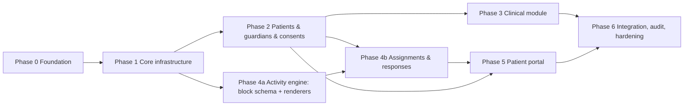

# Development Roadmap

Status: **Proposed. Waiting for client approval of Phase 0.** No phase after Phase 0 starts without
explicit approval.

Inputs: `PRODUCT_REQUIREMENTS.md` (172 requirements: 114 Must / 37 Should / 15 Could / 6 Won't),
`ARCHITECTURE.md`, `DATABASE.md`, `DECISIONS.md` (ADR-001…018, Q-01…Q-17), `SECURITY.md`,
`DESIGN_SYSTEM.md`.

## 1. Release strategy

There are 114 Must requirements. A clinical-data product can't ship half of its security, so the
**security and isolation Musts are never deferred**. Clinical and portal breadth is staged instead:

| Release | Audience | Content |
|---|---|---|
| **Alpha (internal)** | SyV + Daniela, synthetic data only | Phases 1–3 complete; activities in basic form |
| **Pilot (design partner)** | Daniela with real patients, after the legal gates in §5 | Phases 1–5 Musts, security audit passed |
| **MVP GA** | Additional psychologists/organizations | Pilot plus Should items selected from pilot feedback, onboarding, custom-domain decision (Q-02) |

**Pilot entry gate:** consent texts reviewed by legal counsel, DPA signed (Daniela ↔ SyV), hosting
region decided (Q-01), Critical and High security findings closed, backup restore tested.

## 2. Phases, dependencies and owners

Phases 3 and 4 **run in parallel** once Phase 2's patient and care-team model is merged. The block
schema and renderers (4a) depend only on Phase 1, so they can start early.

### Phase 0 — Foundation ✅ (this delivery)
Agents, brand research (provisional), design system proposal, requirements, journeys, architecture,
database model, API contracts, ADRs, security review, roadmap.
**Exit:** client approves the foundation and answers the blocking questions in §4.

### Phase 1 — Core infrastructure
| Workstream | Owner | Depends on | Parallel with |
|---|---|---|---|
| 1.1 Repo scaffold: Next.js, TS strict, ESLint, Prettier, Vitest, Playwright, CI skeleton, env validation | architect → frontend/backend | none | 1.6 |
| 1.2 Supabase local setup, migration conventions, base schema (organizations, profiles, memberships, membership_roles, invitations, platform_admins, audit_logs) | backend | 1.1 | 1.4, 1.5 |
| 1.3 Auth: sign-in, recovery, invitations, TOTP MFA + AAL2 enforcement | security + backend | 1.2 | 1.5 |
| 1.4 AuthZ core: `AuthzContext`, permission registry, `requirePermission()`, RLS helper functions, tenant isolation policies | security (design/review) + backend | 1.2 | 1.5 |
| 1.5 i18n foundation: next-intl routing, `messages/es.json` and `en.json`, key-parity CI check, locale preference | frontend | 1.1 | 1.2–1.4 |
| 1.6 Design system implementation: tokens → CSS variables, shadcn/ui theming, base components, app shells (dashboard, portal adult/child) | designer (spec) → frontend | 1.1 | 1.2–1.5 |
| 1.7 Organization branding: `organization_branding`, contrast guard, theme injection, tenant resolution (ADR-017) | backend + frontend, security review | 1.4, 1.6 | none |
| 1.8 Audit writer + event catalog | backend, security review | 1.2 | 1.3–1.7 |
| 1.9 Tests: RLS pgTAP harness, synthetic personas, permission matrix generator, E2E sign-in + MFA | qa (escalate to sonnet for RLS harness) | 1.3, 1.4 | none |

**Exit gate:** cross-tenant isolation tests green, MFA enforced for staff, security approval for
1.3, 1.4, 1.7 and 1.8, CI green from a clean clone.

### Phase 2 — Patient management
Patients (adult/minor), care team, guardians and `patient_guardian_permissions`, invitations for
patients/guardians, consent templates and versions, consent records with evidence, minor assent,
revocation.
Owners: clinical (requirements) → backend + frontend; security review is mandatory; qa covers guardian
permission states (active/revoked/expired) and the minor flows.
**Blocked by:** Q-03, Q-04, Q-17 and the psychologist's input on intake fields.

### Phase 3 — Clinical module (parallel with Phase 4)
Clinical records and structured sections with revisions, assessments, diagnoses (entered by the
professional), treatment plans and goals, therapy sessions (record only, no scheduling engine),
clinical notes with draft → finalized states and addenda (DB immutability triggers), clinical
documents (private storage, signed URLs).
Owners: clinical → backend + frontend; security review is mandatory.
**Blocked by:** section keys and note types from Daniela (`[NEEDS PSYCHOLOGIST INPUT]`), Q-12.

### Phase 4 — Activities (parallel with Phase 3)
- **4a** Block schema (Zod discriminated union, versioned), renderer registry, adult and child renderers, builder UI, draft/publish/archive, immutable versions. *Can start after Phase 1.*
- **4b** Resource library and shares, assignments pinned to a version, patient responses per item, psychologist review views, progress tracking (raw responses, no scoring conclusions).

Owners: activities (lead), designer (builder and player UX), frontend, backend; security review of
media handling and response visibility.
**Blocked by:** the clinically appropriate game types and emotion sets from Daniela, Q-13.

### Phase 5 — Patient portal
Portal home, assigned activities, activity player, resources, objectives, shared documents, account
and preferences, guardian views limited by permissions, child sign-in model (see SECURITY.md),
data-subject request intake (Q-14), crisis/safety wording (`[NEEDS PSYCHOLOGIST INPUT]`).
Owners: frontend + activities + designer; security review; qa runs E2E and a11y in adult and child modes.

### Phase 6 — Final integration
Spanish/English verification, responsive and accessibility audit (WCAG 2.2 AA), full security audit,
permission matrix completeness, E2E suite, performance budget, backup and restore drill (DB and
storage), deployment runbooks, pilot-gate checklist.

## 3. Cross-cutting tracks (all phases)

| Track | Owner | Notes |
|---|---|---|
| Security review of each sensitive module | security | Critical/High findings block merge |
| Documentation upkeep | owner of each doc | Updated in the same PR as the behavior change |
| Brand finalization | designer | Starts when Daniela's assets arrive; token swap only, no structural change |
| Legal workstream | SyV + external counsel | Items tagged `[NEEDS LEGAL VERIFICATION]` |
| Clinical input | clinical + Daniela | Items tagged `[NEEDS PSYCHOLOGIST INPUT]` |

## 4. Decisions needed before or during Phase 1

| Needed by | Item | Source |
|---|---|---|
| Phase 1 start | Approve the stack and ADR-001…021 (or request changes) | DECISIONS.md |
| Phase 1 start | **ADR-019 database access path** (Option A recommended: no direct Data API access for users) — resolves Critical finding F-01 | DECISIONS.md, SECURITY.md §11 |
| Phase 1 start | Security re-review of the revised break-glass design (F-02) and the `read_only` organization status (F-26) | SECURITY.md |
| Phase 1 start | Subdomain-only tenancy for MVP (Q-02) | DECISIONS.md |
| Phase 1 (1.6) | Vector logo (coming from the client). Already decided 2026-11-08: name "Psicóloga Daniela Ortega", #A73C37 primary, adolescents → child portal, "tú" | BRAND_GUIDELINES.md, DECISIONS.md (client log) |
| Phase 2 | Who manages consent templates: owner only, or owner and psychologist (F-24) | SECURITY.md, PRODUCT_REQUIREMENTS.md CON-01 |
| Phase 1 (1.3) | MFA policy for patients/guardians (Q-07); child sign-in model | DECISIONS.md, SECURITY.md |
| Before pilot | Hosting region (Q-01), DPA, consent text review, retention periods (Q-05) | Legal |
| Phase 2 | Owner visibility (Q-03), adolescent/guardian rules (Q-04), e-consent form (Q-17) | DECISIONS.md |
| Phase 3 | Record sections, note types, single vs. multiple episodes (Q-12) | Daniela |
| Phase 4 | Game catalog, emotion sets, objective visibility (Q-13) | Daniela |

## 5. Definition of done (every feature)

Requirements have IDs and acceptance criteria · Zod validation at the server boundary · server authz
check plus RLS policy · audit events emitted · es and en strings · responsive, with empty, loading and
error states · unit, integration and RLS tests, and E2E where it is a critical flow, all run with real
output · security review where sensitive data is involved · docs updated.
